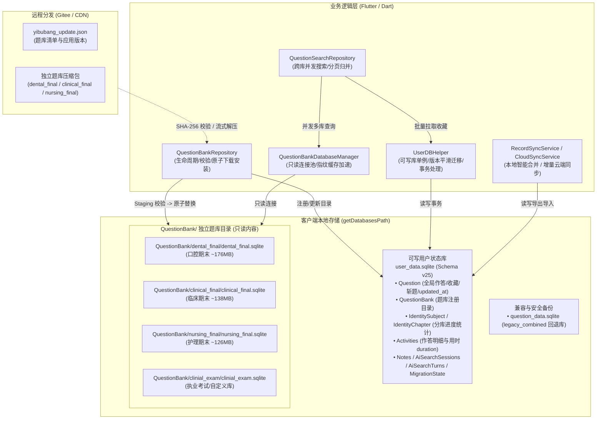
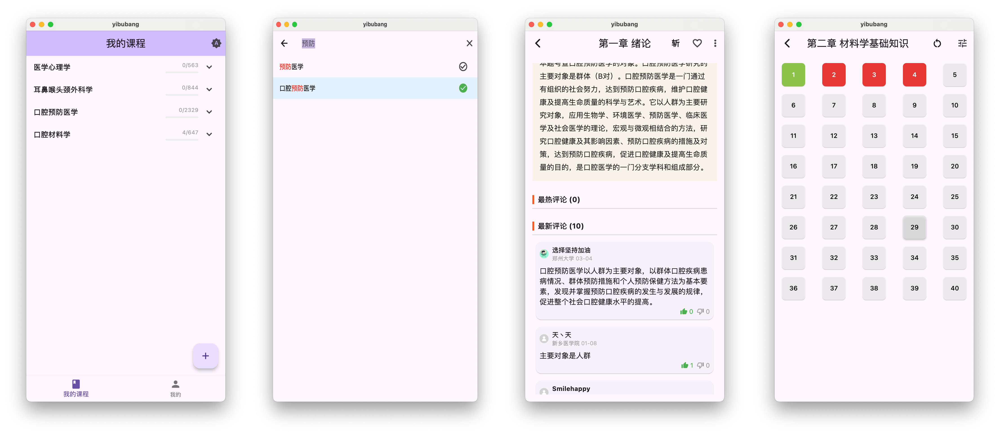
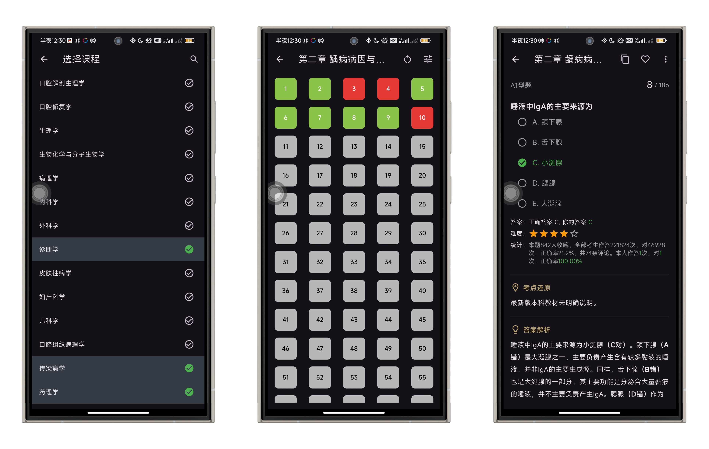
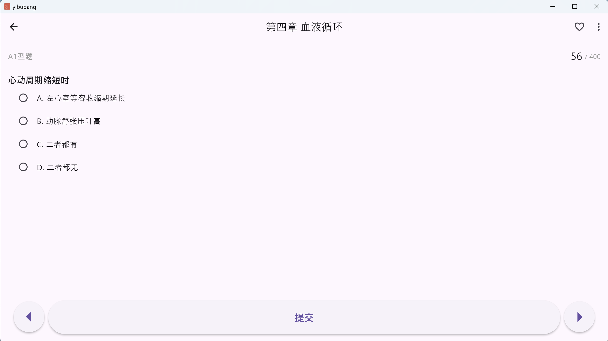
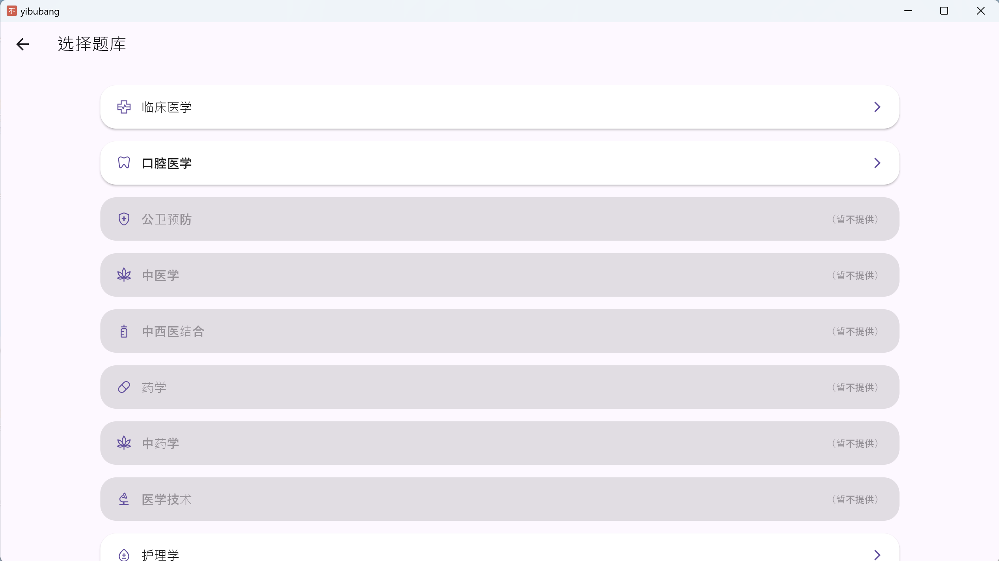

<p align="center">
  <br>
  <h1 align="center">医不帮 (Yibubang)</h1>
  <p align="center"><strong>专为医学生打造的现代化、离线优先、跨平台刷题与复习利器</strong></p>
  <p align="center">A Modern, Offline-First, Cross-Platform Medical Exam Preparation App for Medical Students.</p>
  <div align="center">
    <a href="https://github.com/nanguaguag/yibubang"></a>
    <a href="https://github.com/nanguaguag/yibubang/blob/main/LICENSE"></a>
    <a href="https://github.com/nanguaguag/yibubang/actions/workflows/android.yml"></a>
    <a href="https://github.com/nanguaguag/yibubang/actions/workflows/macos.yml"></a>
    <a href="https://github.com/nanguaguag/yibubang/actions/workflows/windows.yml"></a>
    <a href="https://github.com/nanguaguag/yibubang/actions/workflows/linux.yml"></a>
    <a href="https://t.me/yibubang"></a>
  </div>
  <br>
  <div align="center">
    <strong><a href="#-项目简介">🇨🇳 简体中文</a></strong> •
    <strong><a href="README_EN.md">🇺🇸 English</a></strong>
  </div>
</p>

---

## 目录

- [项目简介](#-项目简介)
- [核心特性](#-核心特性)
- [AI 搜索与教材阅读](#-ai-搜索与教材阅读)
- [数据库与技术架构](#-数据库与技术架构)
- [内置与支持题库](#-内置与支持题库)
- [平台支持与下载](#-平台支持与下载)
- [快速上手与构建](#-快速上手与构建)
- [功能进展 (Roadmap)](#-功能进展-roadmap)
- [验证与开发文档](#-验证与开发文档)
- [界面预览](#-界面预览)
- [社区交流与开源许可 / Community & License](#-社区交流与开源许可--community--license)

---

### 💡 项目简介

**医不帮 (yibubang)** 是一款面向医学生的开源跨平台专业刷题工具。传统刷题软件常受制于强制联网、臃肿广告、缺乏桌面端适配以及题库绑定等痛点。医不帮采用 **Flutter** 驱动与 **离线优先 (Offline-First)** 理念，在手机、平板与电脑（Android、Windows、macOS、Linux、iOS）上提供一致流畅的高性能刷题体验。

项目采用彻底解耦的 **“多题库物理拆分 + 全局共享用户状态”** 架构，题库与作答数据物理隔离，在保障数十万道专业医学题目随开随刷的同时，让用户的答题记录、错题、收藏和刷题流水永远安全留存于本地。

---

### ✨ 核心特性

- 💻 **全平台桌面与移动端无缝协同**
  - 原生适配 Android、Windows、macOS、Linux，iOS/iPadOS 适配中。
  - 支持快捷键翻页、响应式桌面大屏排版与移动端单手操作优化。
- ⚡️ **快速启动，纯净无广告**
  - 零启动广告、零捆绑推广；本地题库和个人学习记录支持离线使用。
  - 题库校验与统计投影使用缓存；桌面隐藏页面按需挂载，减少重复扫描与初始化。实际启动时间取决于设备、题库和首次安装状态。
- 🎯 **多样化刷题与复习模式**
  - **练习模式**：即时判断正误，查看详尽解析、真题年份归属、知识点标签与高分辨率配图。
  - **快刷模式**：专注高效刷题，自动流转，提升过题密度。
  - **测试模式**：模拟考场环境，隐藏答案即时反馈，底部考卷状态栏快速交卷，生成全维度测验报告。
  - **背题模式**：直接显示参考答案与精解，考前冲刺突击记忆神器。
  - **多维过滤**：支持按题型（单选/多选）、斩题状态（全部/已斩/未斩）、作答类别（全部/错题/收藏/未做）灵活自由筛选。
- 📊 **学习统计看板与可视化热力图**
  - 毫秒级答题用时追踪（`duration`），精准记录每道题的思考时长。
  - GitHub 风格的 **“刷题格子墙 / 活跃热力图”**，直观呈现每日答题量与复习专注时长。
  - 课程与章节双层进度统计、正误率图表与历史活动明细回溯。
- 🔍 **全库高并发全文检索**
  - 支持跨所有已启用题库并发模糊检索，覆盖题干、选项、解析与考点还原。
  - 分页流畅呈现，一键直达原题，跨库批量同步收藏与斩题状态。
- 📅 **每日计划与自制闪卡**
  - 选择复习范围，按到期计划复习，支持卡包管理与从题目笔记制作闪卡。
  - 保留答题用时、复习记录与本机学习设置，便于持续跟踪学习进度。
- ✨ **有来源的 AI 医学搜索**
  - 教材和题库独立检索，使用内置 Gemini 回答；支持流式显示、追问、修改重试与本机会话。
  - 引用可打开原题或教材原页；支持 Markdown、公式和组合编号引用。
- 📖 **教材检索与页图阅读**
  - 已接入 53 本教材、20,669 页，支持书名筛选、关键词高亮和页面缩略图。
  - 教材页支持缩放、翻页、跳页与本地缓存；已缓存页可离线阅读。
- 🔄 **数据备份与同步**
  - **本地归档导出/导入**：将作答进度一键打包为 `.zip` 文件，导入支持“全量覆盖”与“智能合并”（本地优先、收藏斩题取并集、流水去重追加）。
  - **自建云同步**：通过配对码连接独立同步服务；客户端具备增量变更队列、服务端序号与确认机制。协议 v2 服务端配置和真实账号验收仍需完成，AI 会话不加入跨设备同步。
  - **医考帮在线交互**：支持登录查看题目官方评论区及精选回复；离线队列（斩题/作答/重做章节）待联网后自动上报同步。

---

### ✨ AI 搜索与教材阅读

AI 搜索默认位于底栏「每日计划」与「统计」之间，桌面端使用侧栏入口；导航顺序可自定义。

- **提问与追问**：从检索、整理资料到流式回答，支持继续追问、修改问题后重试、停止回答与复制全文。
- **引用直达原文**：正文编号和参考卡片可点击；题目打开已安装的原题，教材打开对应源版本的 PDF 物理页。
- **会话保存在本机**：可新建、切换和删除会话，关闭 App 后保留历史；生成需要联网，有限历史会随追问提交服务端/Google。
- **统一设置**：「设置 → 通用」下方的「AI 搜索」包含回答模型、问题改写、流式输出、检索条目数和教材/题目比例。默认 12 条、8 教材/4 题，可调 1–25 条；调整总数会尽量保持来源比例。
- **每日额度**：每安装每天 200 次额度，基础生成消耗 1 次、仅问题改写 2 次、改写与流式同时开启 3 次。默认可进行 66 次完整高级提问，余 2 次可换模式使用；这是 App 用量限制，不是 Google 收费倍数。
- **教材检索**：AI 页面右上书本按钮进入教材检索，可按书名筛选并查看关键词片段与右侧缩略图。阅读器支持双指缩放、翻页、页码跳转、失败重试与最近 160 页离线缓存。
- **桌面快捷键**：`Shift+Enter` 发送问题，教材阅读器左右方向键翻页；输入框和弹窗内保留正常编辑操作。

模型目录优先显示本机缓存或备用目录，后台经 Cloud Run 更新，客户端无需访问 Google 模型官网。文本回答使用 Vertex AI Search / Agent Search 内置 Answer/streamAnswer；原 PDF 留在本地，Google 仅导入清洗文本，页图通过私有 R2 与 `textbooks.melonhu.com` 提供。

检索数量是提供给回答的片段上限，模型不保证采用所有片段或穷尽整个知识库。医学答案、OCR 符号、单位和公式请对照原文核实。专项赠金适用范围仍需实际 SKU 账单确认；后端运行费用不能一概视为免费。

[AI 使用与部署](docs/ai-search/README.md) · [检索数量与来源比例](docs/ai-search/RETRIEVAL_LIMITS.md) · [模型和费用](docs/ai-search/COSTS_AND_BUILTIN_MODELS.md) · [教材处理与上传](docs/knowledge-base/TEXTBOOK_EXECUTION.md)

---

### 🗄 数据库与技术架构

项目基于 SQLite 构建了兼具高性能、高扩展与强容灾的存储架构，遵循 **“内容只读与用户可写物理分离”** 的核心原则：



#### 架构技术亮点
1. **全局 Question ID 契约**：题目 ID 全局唯一。同道题目出现在多个题库（例如临床期末与执业医师）时，答题状态、斩题和收藏自动互通，无需重复做题。
2. **原子更新与自动回滚机制**：题库更新采用 `.staging` 暂存下载解压，通过 5 重安全校验后原子替换正式文件，更新前自动生成 `.bak` 备份，失败时秒级回滚。
3. **文件指纹校验缓存**：将 `size:modifiedTime` 指纹持久化于本地，二次启动直接跳过百兆 SQLite 的 `PRAGMA integrity_check` 全库扫描，启动速度提升数百倍。
4. **历史库平滑降级（Fail-safe）**：对老用户保留旧版单体 `question_data.sqlite` 作为 `legacy_combined` 回退源，即便新题库损坏亦可无感平滑刷题。
5. **ATTACH 跨库重算**：提供纯 SQL 高性能统计校准，通过 `ATTACH DATABASE` 在毫秒级完成数十万题目的跨库归并与进度自愈。

> 详细数据库设计文档请参阅：[docs/antigravity/database_current.md](docs/antigravity/database_current.md)。

---

### 📚 内置与支持题库

系统支持多套官方专业题库独立下载、更新与管理，并允许用户无缝导入自定义扩展题库：

| 题库标识 (`bank_id`) | 题库官方名称 | 题目规模 | 课程数 | 章节数 | 题库包体大小 (ZIP / 解压后) | 状态 |
| :--- | :--- | :---: | :---: | :---: | :---: | :---: |
| `dental_final` | **口腔期末题库** | 78,310 | 45 | 1,132 | ~32.5 MB / ~176 MB | 官方已发布 |
| `clinical_final` | **临床期末题库** | 57,346 | 40 | 1,137 | ~25.9 MB / ~138 MB | 官方已发布 |
| `nursing_final` | **护理期末题库** | 69,591 | 50 | 928 | ~24.1 MB / ~126 MB | 官方已发布 |
| `clinial_exam` | **临床执业医师考试** | 18,806 | 22 | 540 | ~12.0 MB / ~57 MB | 扩展支持 |
| *自定义题库* | 用户本地导入 (`.sqlite` / `.zip`) | 自适应 | 自适应 | 自适应 | 不限 | 开放支持 |

---

### 📥 平台支持与下载

| 操作系统 | 支持架构 / 安装包格式 | 当前支持状态 |
| :--- | :--- | :---: |
| **Android** | `arm64-v8a`, `armeabi-v7a`, `x86_64`, `Universal APK` | ✅ 稳定支持 |
| **Windows** | `x64` 免安装压缩包 / 便携版 | ✅ 稳定支持 |
| **macOS** | `Apple Silicon (arm64)`, `Intel (x86_64)` DMG / App | ✅ 稳定支持 |
| **Linux** | `x86_64` (Tar.gz / AppImage) | ✅ 稳定支持 |
| **iOS / iPadOS** | 移动端适配与签名调试 | 🚧 积极适配中 |

- 📦 **GitHub Releases**：[https://github.com/nanguaguag/yibubang/releases](https://github.com/nanguaguag/yibubang/releases)
- 🚀 **Gitee 国内镜像分发**：[https://gitee.com/pumpkin_melon/yibubang/releases](https://gitee.com/pumpkin_melon/yibubang/releases)

---

### 🛠 快速上手与构建

#### 环境要求

- [Flutter SDK](https://flutter.dev/) `>= 3.32.0`
- [Dart SDK](https://dart.dev/) `>= 3.8.0，< 4.0.0`
- 对应目标平台编译环境（Android Studio / Xcode / Visual Studio C++ 工具集 / Linux build-essential）

#### 本地运行与打包

```bash
# 1. 克隆代码仓库
git clone https://github.com/nanguaguag/yibubang.git
cd yibubang

# 2. 安装项目依赖
flutter pub get

# 3. 本地调试运行 (根据连接的设备或桌面环境)
flutter run

# 4. 构建指定平台发行包
# Android APK
flutter build apk --split-per-abi

# Windows 桌面端
flutter build windows

# macOS 桌面端
flutter build macos

# Linux 桌面端
flutter build linux
```

---

### 🗺 功能进展 (Roadmap)

- [x] 多题库物理拆分与独立动态下载/更新（口腔、临床、护理、执业医师）
- [x] 全题库高并发模糊搜索与收藏状态快速拉取
- [x] 刷题时长毫秒级记录与 GitHub 风格做题格子墙（打卡热力图）
- [x] 四种刷题模式（练习、快刷、测试、背题）与多维度筛选（斩题/错题/收藏）
- [x] 考前背题与测试模拟交卷评分机制
- [x] 本地做题记录 ZIP 导出与智能双向合并（Merge）
- [x] 配对码同步客户端与持久化变更/确认队列
- [ ] 同步协议 v2 服务端配置与真实账号验收
- [x] 医考帮离线同步队列（斩题/答题/重做章节联网后自动上报）
- [x] 查看题目在线评论区与精选社区讨论
- [x] 自定义第三方题库导入与元数据自动化校验
- [x] 字体缩放（0.85x ~ 1.3x）与深色/浅色主题无缝切换
- [x] 每日计划、自制闪卡与学习统计
- [x] AI 搜索、流式回答、追问/编辑重试与本机会话管理
- [x] 题目/教材引用直达原文，Markdown 公式与组合引用
- [x] 回答模型/高级选项、1–25 条证据与教材/题目比例设置
- [x] 53 本教材文本检索、关键词缩略图、页图缩放与离线缓存
- [x] 桌面提问/教材翻页快捷键与自定义导航
- [ ] 最新 AI/教材改动的正式 Release 与各平台真机/目标地区网络验收
- [ ] iOS / iPadOS 正式包打包与签名指南
- [ ] Web 端轻量化查询与学习报告只读查看器

---

### ✅ 验证与开发文档

当前源码版本仍为 `2.2.3+213`，用户库 schema 25。AI/教材功能已部署独立后端并完成 Android/macOS Debug 构建，尚未发布包含全部最新功能的新 Release；历史下载包不保证包含这些改动。

最新本机复核使用 Flutter 3.50.0 / Dart 3.14.0：357 项 Flutter 测试通过、3 项联网测试默认跳过；此前后端 39 项通过。已修复 CI 发现的笔记异步返回 warning，并隔离设置测试触发的无关后台网络。`dart analyze` 与 CI 的 `flutter analyze --no-fatal-infos` 均成功，0 个 error / warning，119 个弃用 info。远程四平台 Actions 尚未重跑，完整 CI 结果以 Actions 记录为准。

[文档总目录](docs/README.md) · [当前进度](docs/CURRENT_STATUS.md) · [开发交接](docs/antigravity/SESSION_HANDOFF.md) · [测试与验证](docs/antigravity/TESTING_STRATEGY.md)

---

### 📸 界面预览

<p align="center">
  
  
</p>
<p align="center">
  
  
</p>

---

### 社区交流与开源许可 / Community & License

- **Telegram**: [https://t.me/yibubang](https://t.me/yibubang)
- **Open Source License**: Distributed under the [MIT License](LICENSE).
