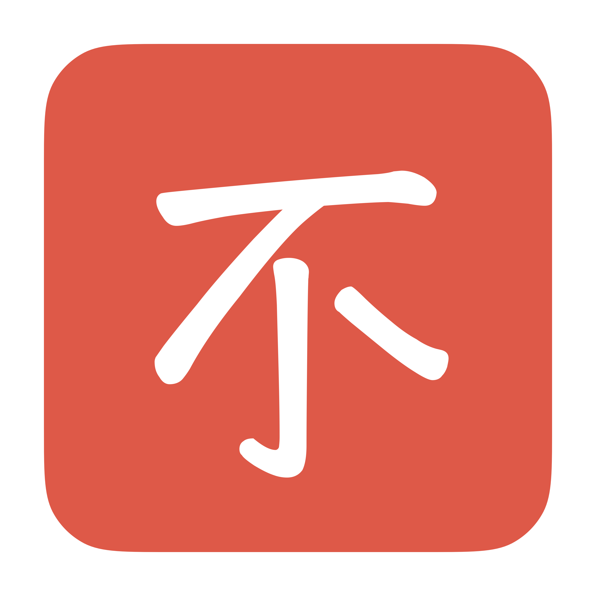
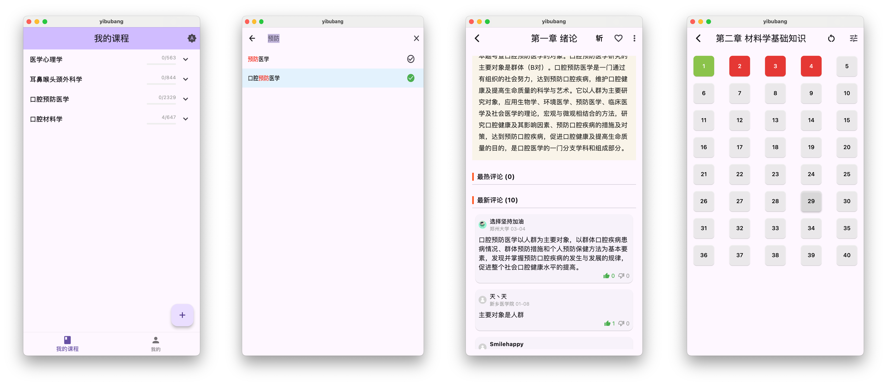
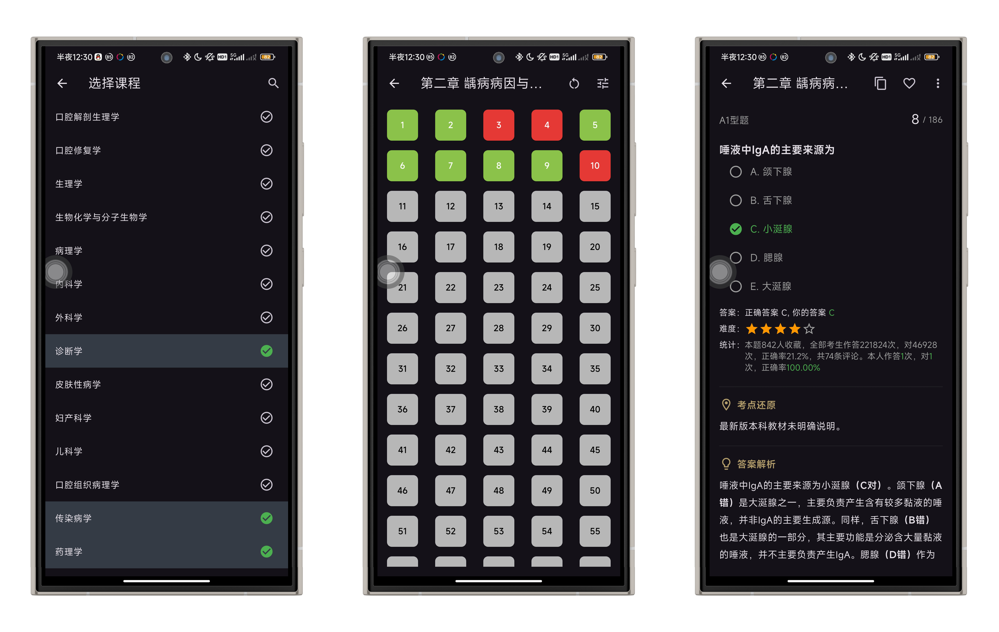
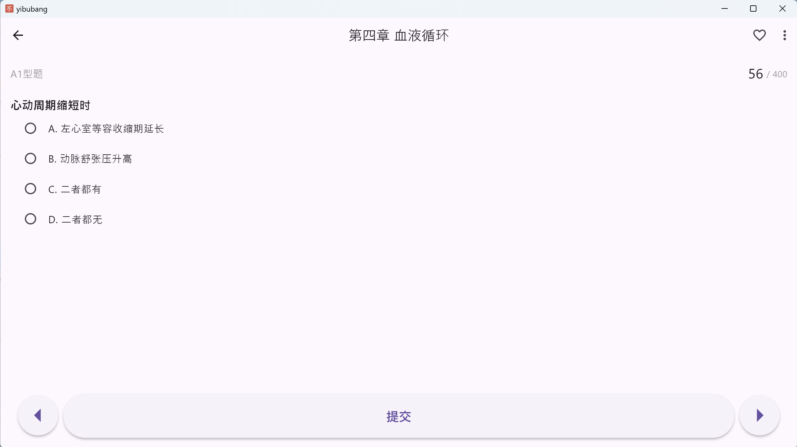
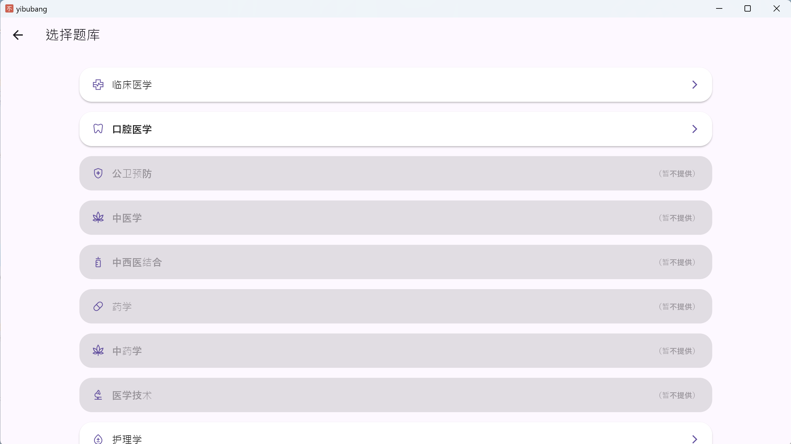

   
  <h1 align="center">医不帮 (Yibubang)</h1>
  
<strong>专为医学生打造的纯净、离线可用、全平台刷题与智能复习助手</strong>

  
A Clean, Offline-First, Cross-Platform Medical Exam Prep &amp; Smart Review App.

  

    
    
    
    
    
    
    
  

   
  

    <strong><a href="#-为什么选择医不帮">🇨🇳 简体中文</a></strong> •
    <strong><a href="README_EN.md">🇺🇸 English</a></strong>
  

---

### 💡 为什么选择医不帮？

传统刷题软件往往广告满天飞、没网就打不开、电脑端体验差，不同题库之间做过的题还要重复刷。**医不帮**是一款完全免费开源的医学刷题工具，致力于让备考回归纯粹与高效：

- **零广告、不卡顿**：打开即刷，无开屏广告、无弹窗推广。
- **断网也能刷**：题库和做题记录全部保存在本地，图书馆地下室、高铁、飞机上都能流畅使用。
- **全平台互通**：支持 Android 手机/平板以及 Windows、macOS、Linux 电脑（iOS 适配中），支持键盘快捷键高效刷题。
- **进度全局共享**：同一道真题如果同时出现在期末考库和执业医师考库中，做对、错题、收藏和“斩题”状态自动同步，不用重复做！

---

### ✨ 核心功能

- 🎯 **四种刷题模式，满足不同备考阶段**
  - **练习模式**：做一题看一题解析，附带年份标签、考点还原与高清配图。
  - **快刷模式**：答题后自动切换下一题，适合快速过题。
  - **测试模式**：还原真实考场，交卷后统一出分并生成错题报告。
  - **背题模式**：直接展示答案与解析，考前突击背诵神器。
  - 支持按题型、错题、收藏、未做以及“已斩/未斩”自由组合筛选。

- 🧠 **智能记忆复习 & 自制闪卡**
  - 内置科学的遗忘曲线复习算法，每天自动为你安排最需要回顾的错题与笔记。
  - 支持将重要知识点一键制作成正反面**记忆闪卡**，卡片支持粗体/列表排版、公式以及直接拍照上传插图（点击图片可全屏放大浏览）。

- ✨ **AI 医学搜索 & 教材原页直达**
  - 内置有依据的医学 AI 搜索：不懂的概念或易混淆疾病直接提问，支持连续追问。
  - **拒绝 AI 瞎编**：回答正文中的参考编号可直接点击，一键跳回对应**原题**或 **53 本医学电子教材（2 万余页）的对应 PDF 原页**核对原文。

- 📊 **学习统计与打卡墙**
  - 自动统计每道题的思考时长与各学科正确率。
  - 生成类似“格子墙”的每日刷题打卡热力图，直观见证每一天的备考积累。

- 🔄 **数据安全与多端同步**
  - **本地备份**：随时将全部做题记录、笔记和闪卡打包导出为压缩包保存，支持智能合并恢复。
  - **手机与电脑同步**：通过简单的配对码即可跨设备增量同步做题进度、收藏、笔记、闪卡与复习计划；同时支持整库云端冷备快照，换新设备一键还原。
  - **兼容医考帮进度**：支持登录医考帮账号，查看热门题评，并将你的官方做题记录同步过来。

---

### 📚 内置与支持题库

开箱即可在线下载以下专业题库，也支持导入自己的自定义题库包：

| 题库名称 | 题目数量 | 覆盖课程 | 当前状态 |
| :--- | :---: | :---: | :---: |
| **口腔期末题库** | 78,310 题 | 45 门 | ✅ 官方已发布 |
| **临床期末题库** | 57,346 题 | 40 门 | ✅ 官方已发布 |
| **护理期末题库** | 69,591 题 | 50 门 | ✅ 官方已发布 |
| **临床执业医师考试** | 18,806 题 | 22 门 | ✅ 扩展支持 |
| **自定义题库** | 不限 | 自定义 | ✅ 支持本地导入 |

---

### 📥 下载与安装

前往下方发布页选择对应系统的安装包即可使用（桌面端提供免安装压缩包或 DMG 安装包）：

- 📦 **GitHub Releases**：[https://github.com/nanguaguag/yibubang/releases](https://github.com/nanguaguag/yibubang/releases)
- 🚀 **Gitee 国内高速镜像**：[https://gitee.com/pumpkin_melon/yibubang/releases](https://gitee.com/pumpkin_melon/yibubang/releases)

| 平台 | 支持情况 | 说明 |
| :--- | :---: | :--- |
| **Android** | ✅ 稳定支持 | 提供常规通用包及各架构精简安装包 |
| **Windows** | ✅ 稳定支持 | 解压即用的绿色便携版，支持键盘快捷键 |
| **macOS** | ✅ 稳定支持 | 同时支持 Apple Silicon (M 系列) 与 Intel 芯片 |
| **Linux** | ✅ 稳定支持 | 提供压缩包 / AppImage |
| **iOS / iPadOS** | 🚧 适配中 | 正在积极适配与调试中 |

---

### 📸 界面预览

  
  

  
  

---

### 🛠 开发者与技术文档

如果您是开发者，想了解本项目的源码构建方式、本地数据库设计、云端同步协议或 AI 搜索后端部署细节，请参阅 `docs/` 目录下的完整文档：

- [文档总目录](docs/README.md) · [当前开发进度](docs/CURRENT_STATUS.md) · [更新日志](docs/release-notes/v2.2.4.md)
- [系统架构与同步协议](docs/antigravity/ARCHITECTURE.md) · [数据库设计](docs/antigravity/database_current.md) · [AI 搜索与教材部署](docs/ai-search/README.md)
- [测试策略与验证](docs/antigravity/TESTING_STRATEGY.md) · [跨会话开发交接](docs/antigravity/SESSION_HANDOFF.md)

---

### 💬 社区交流与开源许可

- **Telegram 交流群**：[https://t.me/yibubang](https://t.me/yibubang)
- **开源协议**：本项目基于 [MIT License](LICENSE) 开源，欢迎 Star、反馈问题或提交贡献！
