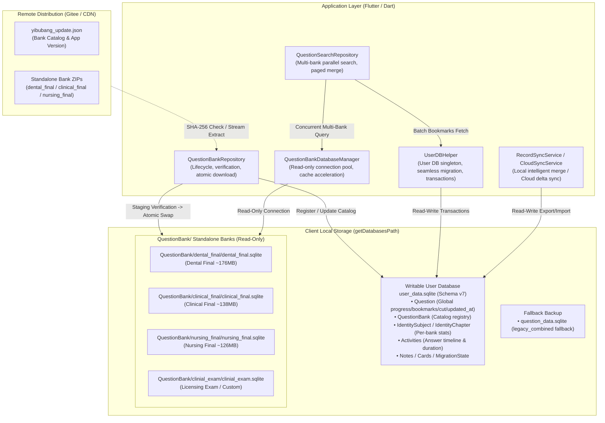

<p align="center">
  <br>
  <h1 align="center">Yibubang (医不帮)</h1>
  <p align="center"><strong>A Modern, Offline-First, Cross-Platform Medical Exam Preparation App for Medical Students</strong></p>
  <div align="center">
    <a href="https://github.com/nanguaguag/yibubang"></a>
    <a href="https://github.com/nanguaguag/yibubang/blob/main/LICENSE"></a>
    <a href="https://github.com/nanguaguag/yibubang/actions/workflows/android.yml"></a>
    <a href="https://github.com/nanguaguag/yibubang/actions/workflows/macos.yml"></a>
    <a href="https://github.com/nanguaguag/yibubang/actions/workflows/windows.yml"></a>
    <a href="https://github.com/nanguaguag/yibubang/actions/workflows/linux.yml"></a>
    <a href="https://t.me/yibubang"></a>
  </div>
  <br>
  <div align="center">
    <strong><a href="README.md">🇨🇳 简体中文 (Chinese Version)</a></strong> •
    <strong><a href="#-table-of-contents">🇺🇸 English (Current)</a></strong>
  </div>
</p>

---

## 📑 Table of Contents

- [💡 Introduction](#-introduction)
- [✨ Key Features](#-key-features)
- [🗄 Architecture & Database Design](#-architecture--database-design)
- [📚 Supported Question Banks](#-supported-question-banks)
- [📥 Platform Support & Downloads](#-platform-support--downloads)
- [🛠 Getting Started & Build Guide](#-getting-started--build-guide)
- [🗺 Roadmap](#-roadmap)
- [📸 Snapshots](#-snapshots)
- [💬 Community & License](#-community--license)

---

### 💡 Introduction

**Yibubang (医不帮)** is an open-source, cross-platform medical exam practice and revision software designed specifically for medical students. Traditional test preparation tools often suffer from mandatory internet connectivity, obtrusive advertisements, lack of desktop platform support, and rigid database tie-ins. 

Powered by **Flutter** and engineered with an **offline-first** design philosophy, Yibubang provides a seamless, distraction-free, and blazing-fast experience across Android, Windows, macOS, Linux, and iOS/iPadOS.

With its innovative **"Split Question Banks + Globally Shared User State"** architecture, question content is strictly decoupled from user progress. While hosting hundreds of thousands of medical questions locally, all your answers, wrong problem sets, bookmarks, and activity logs remain securely stored on your own device.

---

### ✨ Key Features

- 💻 **True Cross-Platform Collaboration**
  - First-class support for Android, Windows, macOS, and Linux (iOS/iPadOS support underway).
  - Optimized keyboard shortcuts for desktop navigation and refined ergonomics for mobile devices.
- ⚡️ **Blazing Fast Startup & Zero Advertisements**
  - Instant cold launch without commercial splash screens, tracking, or mandatory logins.
  - Persistent file fingerprint caching accelerates cold SQLite initialization to sub-5ms.
- 🎯 **Four Specialized Practice Modes**
  - **Practice Mode**: Immediate validation, comprehensive explanations, original exam year references, knowledge tags, and zoomable illustrations.
  - **Fast Brush Mode**: High-density question drill interface with automatic progression.
  - **Exam / Test Mode**: Simulated testing conditions with hidden answers, bottom exam navigation bar, and full diagnostic test score reports.
  - **Recitation Mode**: Displays correct answers and detailed rationales directly for rapid pre-exam memorization.
  - **Flexible Filters**: Filter by question type (single/multiple choice), cut status (all/cut/uncut), and question status (all/wrong/bookmarked/unanswered).
- 📊 **Insightful Learning Analytics & Activity Heatmap**
  - Millisecond-precision question timing (`duration`) to measure cognitive effort per question.
  - GitHub-style **practice activity heatmap** displaying daily question counts and focused study time.
  - Double-tier progress tracking (Subject & Chapter) with accuracy curves and historical timeline logs.
- 🔍 **Full-Library Parallel Search**
  - Concurrent multi-bank fuzzy querying across question stems, options, explanations, and recall tags.
  - Paged result rendering with instant jump-to-question and batch synchronization of bookmarks.
- 🔄 **Comprehensive Backup & Synchronization**
  - **Local Archive Export/Import**: Export user database into portable `.zip` bundles. Supports full replacement as well as intelligent merge (local-first answer retention, union of favorites/cut status, idempotent activity appending).
  - **Self-Hosted Cloud Sync**: Simple pairing-code based synchronization using millisecond-level timestamps (`updated_at`) and Last-Write-Wins (LWW) conflict resolution.
  - **YKB Platform Integration**: View official question comments and community replies; offline synchronization queue for cut questions, answers, and chapter redos upon reconnecting.

---

### 🗄 Architecture & Database Design

Yibubang adopts an SQLite storage architecture adhering strictly to **"Physical Separation of Read-Only Content and Read-Write User Data"**:



#### Architectural Highlights
1. **Global `question_id` Contract**: Question identities are globally unique. When a question is shared between different banks (e.g. Clinical Finals and Licensing Exam), answer progress, favorites, and cut states are shared automatically without redundant work.
2. **Atomic Upgrades & Auto-Rollback**: Bank downloads are written to `.staging` files and verified through 5-stage checks before atomic renaming. A `.bak` snapshot is created beforehand, enabling immediate fallback if any error occurs.
3. **Fingerprint Validation Cache**: Persisting file `size:modifiedMilliseconds` avoids costly `PRAGMA integrity_check` scans on cold starts, reducing database initialization time from seconds to <5ms.
4. **Resilient Legacy Fail-Safe**: Existing monolithic `question_data.sqlite` files are retained as `legacy_combined` fallbacks, guaranteeing zero service interruption for long-time users.
5. **ATTACH Cross-Database Recomputation**: High-performance SQL recovery scripts using SQLite's `ATTACH DATABASE` reconcile user stats across hundreds of thousands of records in milliseconds.

> For detailed technical specifications, refer to [docs/antigravity/database_current.md](docs/antigravity/database_current.md).

---

### 📚 Supported Question Banks

| Bank ID | Official Title | Questions | Subjects | Chapters | Package Size (ZIP / Unpacked) | Status |
| :--- | :--- | :---: | :---: | :---: | :---: | :---: |
| `dental_final` | **Dental School Final Exam Bank** | 78,310 | 45 | 1,132 | ~32.5 MB / ~176 MB | Official Release |
| `clinical_final` | **Clinical Medicine Final Exam Bank** | 57,346 | 40 | 1,137 | ~25.9 MB / ~138 MB | Official Release |
| `nursing_final` | **Nursing School Final Exam Bank** | 69,591 | 50 | 928 | ~24.1 MB / ~126 MB | Official Release |
| `clinial_exam` | **Clinical Medical Licensing Exam** | 18,806 | 22 | 540 | ~12.0 MB / ~57 MB | Extended Bank |
| *Custom Banks* | Local User Imports (`.sqlite` / `.zip`) | Adaptive | Adaptive | Adaptive | Unlimited | Fully Supported |

---

### 📥 Platform Support & Downloads

| Operating System | Supported Architectures & Formats | Status |
| :--- | :--- | :---: |
| **Android** | `arm64-v8a`, `armeabi-v7a`, `x86_64`, `Universal APK` | ✅ Stable |
| **Windows** | `x64` Portable ZIP / Standalone Executable | ✅ Stable |
| **macOS** | `Apple Silicon (arm64)`, `Intel (x86_64)` DMG / App | ✅ Stable |
| **Linux** | `x86_64` (Tar.gz / AppImage) | ✅ Stable |
| **iOS / iPadOS** | Mobile build & codesigning testing | 🚧 In Progress |

- 📦 **GitHub Releases**: [https://github.com/nanguaguag/yibubang/releases](https://github.com/nanguaguag/yibubang/releases)
- 🚀 **Gitee Mirror (Fast Mainland China Download)**: [https://gitee.com/pumpkin_melon/yibubang/releases](https://gitee.com/pumpkin_melon/yibubang/releases)

---

### 🛠 Getting Started & Build Guide

#### Prerequisites
- [Flutter SDK](https://flutter.dev/) `>= 3.27.3`
- [Dart SDK](https://dart.dev/) `>= 3.6.1`
- Target platform build toolchains (Android Studio / Xcode / Visual Studio C++ / build-essential)

#### Build Instructions
```bash
# 1. Clone repository
git clone https://github.com/nanguaguag/yibubang.git
cd yibubang

# 2. Fetch dependencies
flutter pub get

# 3. Run in debug mode
flutter run

# 4. Build release packages
flutter build apk --split-per-abi  # Android APK
flutter build windows              # Windows Executable
flutter build macos                # macOS Bundle
flutter build linux                # Linux Binary
```

---

### 🗺 Roadmap

- [x] Multi-bank physical isolation with on-demand download & updates
- [x] High-performance parallel multi-bank search engine
- [x] Millisecond-level question duration timer and GitHub-style activity heatmap
- [x] Four study modes (Practice, Fast Brush, Exam, Recitation) with multi-criteria filters
- [x] Pre-exam quick memorization and mock exam submission report
- [x] Portable ZIP backup with intelligent two-way merge algorithm
- [x] Self-hosted lightweight cloud synchronization via pairing code (LWW delta replication)
- [x] Offline YKB synchronization queue for answers, cut questions, and chapter redos
- [x] Online community comments and reply viewer
- [x] Custom question bank importer with automated integrity validation
- [x] Font scaling (0.85x - 1.3x) and smooth dark/light theme switching
- [ ] iOS / iPadOS official bundle and codesigning documentation
- [ ] Lightweight Web-based question viewer and read-only study report portal

---

### 📸 Snapshots

<p align="center">
  
  
</p>
<p align="center">
  
  
</p>

---

### 💬 Community & License

- 💬 **Telegram Community Chat**: [https://t.me/yibubang](https://t.me/yibubang)
- 📄 **Open Source License**: Distributed under the [MIT License](LICENSE).
