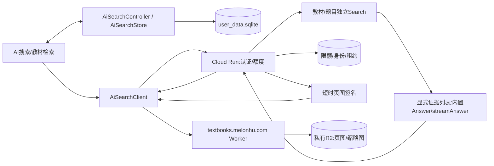

# 当前架构与调用链

更新2026-11-13；用户库schema25/题库schema1。[旧详细架构](../archive/development-history/ARCHITECTURE.md)保留历史字段/行号，当前核查以源码为准。

## 本地内容与用户行为

[database_helper.dart](../../lib/db/database_helper.dart)管理用户库升级；题库正式文件物理只读，安装/合并使用暂存替换。Question.id跨库共享，作答/Activities/笔记留用户库；[data_transfer.dart](../../lib/db/data_transfer.dart)执行ATTACH聚合。桌面/移动文件选择和Dialog/抽屉须保持原适配。

首页M02真实路径指纹、M01精准revision刷新与M03隐藏Tab延迟挂载切片已完成；未把目录检查、迁移和所有调度阶段整体重构。云同步协议v2源码及ACK/outbox修复已完成，服务端发布与真实账号验证仍独立待办。

## AI与教材

[页面](../../lib/screens/ai_search_page.dart)→[控制器](../../lib/services/ai_search_controller.dart)→[客户端](../../lib/services/ai_search_client.dart)→[后端](../../ai_backend/app.py)。每轮本机[选项](../../lib/models/ai_search_options.dart)送模型/改写/流式/总数/教材数；后端扣额度前校验，Firestore事务执行服务端日期/并发/重放与1/2/3权重。

[retrieval.py](../../ai_backend/retrieval.py)并行两类过滤Search，按各自排序/去重选片段，默认8:4、总数1–25，单源跳过请求；[builtin_answer.py](../../ai_backend/builtin_answer.py)通过searchResultList发送内置证据，非maxReturnResults自动检索。流式增量SSE与最终全文分离，UTF-8引用校正；非流式收到完整答案后本地渐入。

[AiSearchStore](../../lib/db/ai_search_store.dart)只写本地AI表；异常未完成回合恢复为interrupted。引用题目用全局id查只读安装库；教材用book_id/source_version/pdf_page定位，历史保存稳定身份而非过期URL。

图片仅经签名→Worker→R2，不经Google生成或Cloud Run字节代理。鉴权先于缓存，App稳定键缓存160页/缩略图；Google/后端模型目录有本机快照与后台有界刷新，客户端不直连Google模型官网。

## 数据管线和生命周期

[知识库脚本](../../scripts/knowledge_base/build.py)从内容SQLite/PDF构建本地规范副本、JSONL及差异，Google只增量导清洗文本。[教材工具](../../scripts/knowledge_base/textbooks.py)复用文字层/几何坐标去重并制WebP；成功ID/hash账本和外置盘主副本是续传/迁移依据，不可当临时垃圾删除。

网络返回后检查mounted/取消；route pop后不用旧context；停止/修改/切换会话按既有互斥规则，已受理生成失败不保证退App额度。[部署/限额](../ai-search/README.md) · [数据库](database_current.md)。
