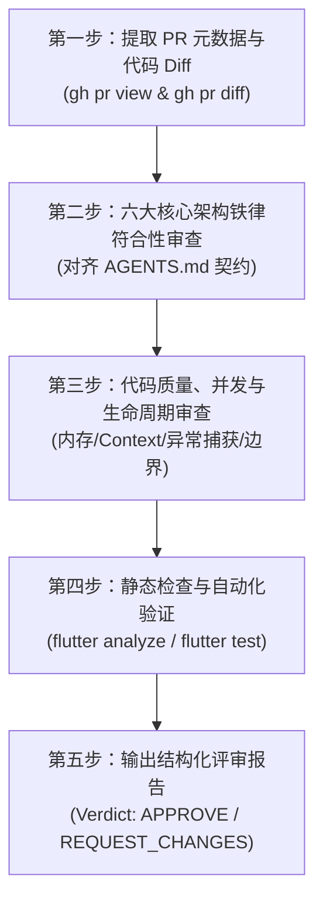

# PR_REVIEW_WORKFLOW.md - 医不帮 (yibubang) Pull Request 代码审查工作流

> 2026-11-13整理：本文保留对应专项的详细规范/历史基线。当前项目schema25、内置AI与最新部署/验证以[当前进度](../CURRENT_STATUS.md)和[交接](SESSION_HANDOFF.md)为准；未经重新核查不套用历史行号。

> **适用场景**：使用 Antigravity Agent 审核外部贡献者或团队成员提交的 Pull Request (PR)。
> **核心工具支撑**：GitHub CLI (`gh`) + Git 只读命令 + Flutter 静态分析与测试。
> **基准知识库索引**：[`docs/antigravity/README.md`](README.md) 与 [`AGENTS.md`](../../AGENTS.md)。

---

## 1. 核心审查原则 (Review Principles)

1. **严格只读审查 (Strictly Read-Only)**：
   - 审查过程中**禁止直接合并 (merge)、改写或推送远端分支**。
   - 所有审查结论以结构化报告形式呈现在会话中，由项目维护者（人类开发者）决定是否 Approve 或 Merge。
2. **知识库与铁律守护 (Guardianship of Core Invariants)**：
   - 任何 PR 代码若违反 [`AGENTS.md`](../../AGENTS.md) 与 [`PROJECT_MEMORY.md`](PROJECT_MEMORY.md) 中的底层铁律（如尝试写入只读题库、破坏全局 Question ID 契约、失活 Context 跳转等），**直接一票否决 (REQUEST_CHANGES)**。
3. **区分事实与推测 (Evidence-Based Review)**：
   - 指出问题必须附带具体文件路径、行号、代码片段与触发条件，禁止凭空臆测。
4. **严防代码回归 (Anti-Regression)**：
   - 重点比对 PR 修改是否踩中 [`KNOWN_ISSUES.md`](KNOWN_ISSUES.md) 中的已知 Bug（如 BUG-01 保存时序倒置、BUG-04 导入后未重算统计等）。

---

## 2. 标准五步审查法 (Five-Stage Workflow)



### 第一步：提取 PR 元数据与差异
使用 `gh` 命令行工具快速了解 PR 背景并拉取 Diff：
```bash
# 1. 查看 PR 详细说明、提交人、目标分支
gh pr view <PR_NUMBER>

# 2. 导出本次 PR 的完整改动 Diff
gh pr diff <PR_NUMBER>
```

### 第二步：六大核心架构铁律审查 Checklist
逐行核对 Diff 是否触碰以下红线：
- [ ] **只读题库物理隔离**：是否包含向 `QuestionBank/<bank_id>/` 写入、更新或执行 DDL 的代码？（**严禁**）
- [ ] **全局 Question ID 契约**：是否将 `bank_id` 错误加入了 `Question` 表的主键？（**严禁**）
- [ ] **跨库重算 ATTACH 规范**：跨库统计重算是否使用了 SQLite 原生 `ATTACH DATABASE`，而非低效 Dart 内存循环？
- [ ] **Context 与导航生命周期**：是否存在 `Navigator.pop(context)` 后继续使用该失活 context 执行跳转的代码？（参考 BUG-02）
- [ ] **跨平台路径与自适应**：文件路径是否均使用 `p.join(...)`？桌面宽屏是否接入了自适应卡片弹窗而非拉伸全屏？
- [ ] **状态字段兼容性**：斩题字段 `cut_question` 是否严格维持 `'1'` (已斩) 和 `'0'` (未斩) 的规范契约？

### 第三步：代码逻辑、并发与边界审查
- **异步安全**：是否有未捕获异常的异步调用？是否有未释放的 `StreamSubscription` 或 `Timer`？
- **内存消耗**：是否有一次性将百兆 SQLite / ZIP 读入连续字节数组（`readAsBytes()`）的 OOM 隐患？
- **数据持久化时序**：设置写入（`saveSettings`）是否在变量赋值之后调用？（防范 BUG-01 类似时序问题）
- **空安全与类型断言**：是否存在 `!` 强解包引发运行时 null 崩溃的隐患？

### 第四步：静态检查与自动化测试验证
在不污染当前工作区的前提下，若拉取了 PR 分支，执行只读静态检查：
```bash
flutter analyze --no-pub
flutter test
```

### 第五步：输出标准化评审报告
报告必须清晰给出结论：
- **`APPROVE`**：代码质量优秀，架构合规，逻辑严谨，无阻断性问题，建议合入。
- **`REQUEST_CHANGES`**：存在阻断性缺陷、逻辑错误或违反核心铁律，列出必须修复的 Blocking Issues。
- **`COMMENT`**：主要是代码风格建议、微小优化，不阻碍核心功能合入。

---

## 3. 标准评审报告模版 (Review Report Template)

每次审查 PR 后，向用户输出以下标准格式的评审结论：

```markdown
# PR #<ID> 评审报告: <PR 标题>

## 1. 评审结论 (Verdict)
- **结论**：[APPROVE / REQUEST_CHANGES / COMMENT]
- **核心判定依据**：<一句话总结核心理由>

## 2. 变更概述 (Summary)
- **作者与分支**：<author>:<branch> -> main
- **涉及文件**：<共修改 X 个文件，+Y 行 / -Z 行>
- **核心功能意图**：<简要说明 PR 解决了什么问题或添加了什么特性>

## 3. 架构铁律与合规性检查 (Iron Rules Check)
- [x] 只读题库隔离契约：符合
- [x] 全局 Question ID 契约：符合
- [x] Context 生命周期安全性：符合
- [x] 跨平台兼容与路径规范：符合

## 4. 重点发现与问题清单 (Key Findings)
### 4.1 阻断性问题 (Blocking Issues - 需作者修复)
1. **[BLOCKER-01] 标题**
   - **位置**：`path/to/file.dart:行号`
   - **原因分析**：...
   - **修改建议**：...

### 4.2 优化建议与坏味道 (Suggestions & Nitpicks)
1. **[NIT-01] 标题**
   - **位置**：`path/to/file.dart:行号`
   - **说明**：...

## 5. 建议给作者的 GitHub 评审回复 (Suggested PR Comment)
<直接可复制到 GitHub PR 对话框的英文/中文回复建议>
```
