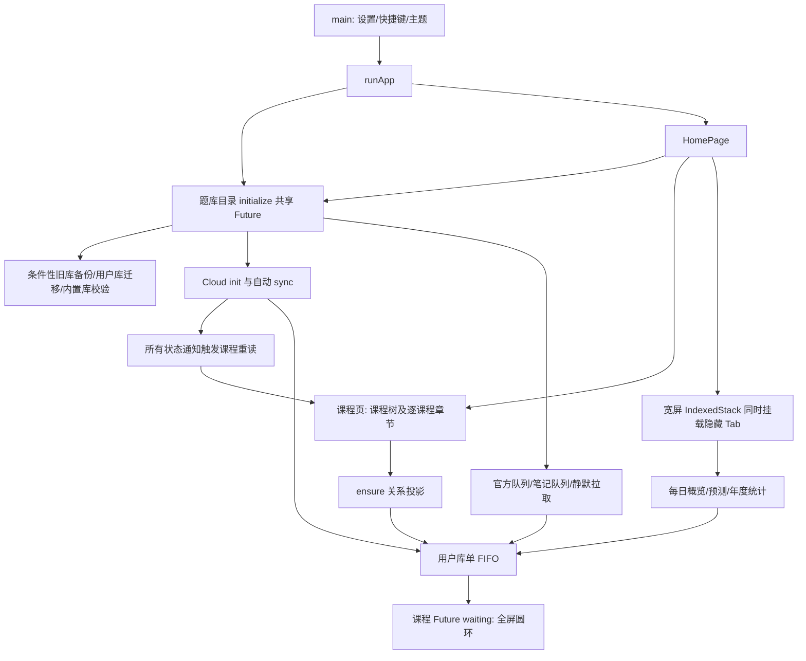

# A01–A20 修复后：启动、同步与长期维护架构审计

> 后续更新：M01/M02与M03隐藏Tab启动切片已实施，完整记录与314/314验收见[首页启动优化记录](HOME_STARTUP_OPTIMIZATION_LOG.md)。以下正文保留d862099审计时事实；M03目录分阶段、M04/M05和其他问题未在本轮实施。

审计日期：2026-11-11。源码基线：`main@d862099`；应用 `2.2.3+213`；用户库 schema **v24**、题库 schema v1。本轮只分析、运行隔离探针、更新文档；未修改产品代码、依赖、schema，未提交、推送或部署。

## 1. 三个问题的直接结论

### 1.1 为什么有时启动后首页一直转圈

已确认的直接链路是：**首页把云同步状态通知当作课程数据变化，无条件启动新的课程查询，并在查询等待时隐藏已显示的内容、重新显示全屏圆环。** `CloudSyncService.init()` 的首次通知、同步开始、同步结束（包括失败）都能触发刷新。后台异步任务没有被首页直接 await，但它们与首页读写共用用户库 FIFO，仍可间接拉长课程读取时间。

本轮还复现了一个更具体的性能缺陷：**题库投影缓存的读取指纹使用传入路径，保存指纹使用 SQLite `PRAGMA database_list` 返回的路径；两者在符号链接/路径别名下不一致。** 本机 `/var/...` 与 `/private/var/...` 指向同一文件，却导致每次 `ensureQuestionCountProjection` 都重新删除、插入全部题目关系。首页读取课程树一次、之后每个选中课程读取章节一次，可能把全库重建放大成多次。

另外两类条件性开销：升级/首次缺备份时复制旧数据库；题库校验缓存缺失或文件变化时完整 `integrity_check`。桌面宽屏又会同时挂载隐藏的每日计划、统计等 Tab，触发全库统计。它们符合“不是每次都慢”的现象，但**尚未收到用户平台、等待时长及现场日志，不能确定实机主因或给出实机耗时**。普通 `/Users/...` 路径未必存在别名缺陷；其余刷新与排队路径仍然成立。

### 1.2 协议 v2 的 FormatException 是否正常

这是**预期的数据保护报错，但表示本次同步没有成功，不能视为正常可用状态**。

客户端发送 `protocol: 2`，只有响应同时包含 `data.protocol == 2` 和数组 `data.accepted_seqs`，才会处理服务器确认。缺任一字段就抛出用户看到的异常，**不会因此删除待上传 outbox**。旧 Worker 返回 HTTP 200 的旧结构可精确触发；网关返回不符合协议的 JSON 也可能触发。该提示本身不能证明是 D1 配额超限或本地 SQLite 损坏。

A01–A20 交接明确记录：后端新增 schema 与 Worker **尚未部署**。因此“客户端已更新、实际后端未同步更新”是目前最强解释。仓库里的 v2 后端代码与测试通过，不能代表线上已运行它。本轮仅匿名 GET 主域名 `/api/health` 与 `/`，分别返回 `status: ok` 和 `service: yibubang-sync-server, version: 1.0.0`；这两个响应没有协议能力字段，且本地 v2 源码也仍写死 `version: 1.0.0`，**不能据此断言线上一定是 v1**。未读取真实账号、未向线上同步接口写数据。

正确处置是对照实际 Worker 发布版本、D1 表/触发器迁移状态，先完成服务端兼容发布，再验证当前客户端。不要清空本机数据、outbox 或用“强制同步/重新配对”替代协议升级；也不要恢复按时间戳删除待传记录的旧方案。

### 1.3 长期维护最值得优化什么

优先顺序：**协议发布闭环 → 首页刷新与投影缓存 → 隐藏 Tab / 统计成本 → 单写队列可观测性与调度 → D1 预算及不可变同步事件 → 搜索、备份与平台验收**。现有物理隔离、原子 outbox、单写临界区和 ATTACH 投影值得保留，逐步抽出明确边界即可；没有证据要求推倒 Flutter/SQLite 架构或全面迁移框架。

另外，正常每日计划卡片入口仍绕过算法设置，A19 的测试没有覆盖这一条实际入口，本轮已用生产部件和真实临时用户库复现。应独立补一个最小修复切片。

## 2. 证据、复现与验证边界

### 2.1 本轮新增隔离探针

探针在系统临时目录创建合成数据库，创建完成后题库以 `readOnly: true` 打开；不读写用户真实数据库、真实题库或线上 D1。

| 入口 | 结果 | 证明的内容 |
| --- | --- | --- |
| [post_a20_current_state_probe_test.dart](post_a20_current_state_probe_test.dart) | 3/3 | 仅云服务初始化通知即可让已显示课程变回圆环；默认卡片入口忽略 `spaced_algorithm=fsrs`；十万题投影和概览开销 |
| [post_a20_backend_probe.mjs](post_a20_backend_probe.mjs) | 2/2 | 固定 seq 上界不等于固定实体快照；一个逻辑同步事件存在多行写放大 |
| 既有 cloud_outbox / coordinator / daily_review_ui / daily_review_service 测试 | 34/34 | 断点、未确认队列保留、临界区、复习已有行为基线 |
| 既有后端 sync_v2 测试 | 8/8 | 幂等、分页、原子回滚、删除墓碑等基线 |
| 后端 `npx tsc --noEmit` | 通过 | 类型检查 |

本轮静态分析在审计探针使用现有测试钩子的局部标注后通过，0 issues。上轮全量 **298/298** 是历史基线，本轮未宣称重跑了全量或完成实机验证。新增探针刻意断言当前缺陷/现状，**不作为修复后应该永远保持全绿的产品门禁**；未来修复时应把期望正确行为移入 `test/`，并相应更新审计探针。

复跑命令（项目根目录）：

```sh
flutter test --no-pub --reporter expanded docs/antigravity/audits/post_a20_current_state_probe_test.dart
node --test docs/antigravity/audits/post_a20_backend_probe.mjs
flutter test --no-pub test/cloud_outbox_test.dart test/user_database_coordinator_test.dart test/daily_review_ui_test.dart test/daily_review_service_test.dart
node --test backend/test/sync_v2_test.mjs
```

### 2.2 性能样本

本机 macOS、Flutter debug 测试进程、FFI SQLite **3.43.2**；合成题库十万题/十万关系、单课程单章节、文件 **7,036,928 bytes**，用户仅一条错题。以下是一次样本，**不是 P95、不是实际医学题干大库，也不能换算成 Android 秒数**。

| 操作 | 样本耗时/结果 |
| --- | --- |
| 首次投影建立 | 120 ms |
| `/var` 别名路径重复 ensure 10 次 | 1,521 ms；`total_changes()` 增加 **2,000,010** |
| `/private/var` 规范路径 ensure 10 次 | 3 ms |
| 已存在关系的显式全量重建 | 151 ms |
| 重建启动后排入 FIFO 的 `SELECT 1` | 等待及查询共 150 ms |
| 完整每日概览连续 3 次 | 234 ms；每次均返回同一条错题统计 |

读写指纹的文件大小/mtime 完全相同，差别仅在路径前缀；别名 10 次产生两百万 SQL 行变更，证实没有命中缓存。实际多课程/多库、更多用户状态、慢磁盘以及冷文件缓存可能放大成本，需 profile 实测。

后端内存 SQL 样本：新题事件、同题更新事件、流水事件各产生 **4 次行变更**；完全相同的事件重投产生 0。这里的 `total_changes()` 包含触发器逻辑变更，**不是 Cloudflare `meta.rows_written` 账单值，也未计索引成本**。

## 3. 启动依赖图与现场定位



关键源码：[`main`](../../../lib/main.dart#L29)、[`_initializeQuestionBank`](../../../lib/main.dart#L66)、[`HomePage._initAsync`](../../../lib/screens/home_page.dart#L46)、[`IndexedStack`](../../../lib/screens/home_page.dart#L234)、[`getSubjectsWithChapters`](../../../lib/screens/choosed_subjects_page.dart#L24)、[`_refreshData`](../../../lib/screens/choosed_subjects_page.dart#L88)、[`FutureBuilder`](../../../lib/screens/choosed_subjects_page.dart#L422)。移动窄屏使用 PageView，不能把桌面同时初始化所有 Tab 的结论直接推广到所有手机启动。

现有日志可以先区分：`[startup] initSettings/runApp`（首帧前）、`[bank-scan]`（持久缓存命中/整库校验）、`getSubjectTreeByIdentity`（课程加载）、`[cloud-sync]`（请求耗时及错误）。静默题库智能更新有 15–34 秒随机延迟（[`_silentBankSmartSync`](../../../lib/main.dart#L106)）；若启动后十几秒再次刷新，可以关联这条任务，而不是假设首页直接等待整个网络超时。

建议新增低成本结构化计时：启动 trace_id、库数量、校验是否命中、投影是否重建、队列 task/priority/wait_ms/run_ms、首次可交互时刻、课程刷新原因和次数。只记录聚合/匿名标识，不记录答案、笔记正文或 token。保留最近若干次慢启动摘要供导出；这样才能从“偶尔转圈”收敛到设备上的真实等待点。

## 4. 风险清单与实施方案

等级：P0 表示数据丢失/恢复风险；P1 表示同步阻塞或明显性能瓶颈；P2 表示体验/边界/维护问题。**本轮未证明当前路径产生了新的实际数据丢失；P0 项明确标为条件性风险。** 工期为单人粗估，需在实机数据、发布环境确认后调整。

| 编号 | 等级 | 发现/方向 | 证据状态 | 建议切片 |
| --- | --- | --- | --- | --- |
| M01 | P2 | 状态通知触发首页/统计无差别重载 | 生产部件复现 | 半天–1天 |
| M02 | P1 | 路径别名导致投影永久缓存失效 | 十万题复现 | 半天–1天 |
| M03 | P1 | 冷启动备份/全目录检查和隐藏 Tab 争抢 | 调用链确定；实机耗时待测 | 1–3天 |
| M04 | P1 | 概览加载完整实体、扫描全范围与串行章节 | 调用链及样本 | 2–4天 |
| M05 | P1 | 单 FIFO 队头阻塞，缺等待预算与优先级 | 并发排队复现 | 2–4天 |
| M06 | P1 | 客户端/Worker/schema 发布脱节 | 报错条件确定；线上协议未确认 | 1–2天及发布验收 |
| M07 | P1 | D1 写放大/全局免费额度，缺预算与冷却 | 内存 SQL；D1计费待测 | 2–5天 |
| M08 | P0风险/P2 | 不可变事件、快照与账号/数据库代际 | seq快照边界复现；其余条件风险 | 2–5天 |
| M09 | P2 | 请求总预算/取消/错误能力模型 | 调用链确定 | 1–2天 |
| M10 | P1 | LIKE/OFFSET 大库搜索、残留参数超限 | 源码确定；旧SQLite实机待测 | 参数1天；搜索另立试点 |
| M11 | P2 | 题库句柄双所有者、业务越过仓库 | 源码确定 | 按模块渐进 |
| M12 | P2/P1 | 统计固定24小时与全量行传输 | 源码确定 | 1–2天 |
| M13 | P2 | 正常卡片入口算法设置失效 | 生产入口复现 | 半天–1天 |
| M14 | P0风险/P1 | 旧迁移备份不含WAL一致性、维护锁太长 | 条件风险/源码确定 | 2–4天及平台故障测试 |
| M15 | P1维护 | 后端CI/部署门禁、平台与文档治理 | 源码确定 | 持续推进 |

### M01：按数据版本刷新，并保留已显示课程

位置：[`ChoosedSubjectsPage.initState/_refreshData`](../../../lib/screens/choosed_subjects_page.dart#L59)、[`CloudSyncService.init`](../../../lib/services/cloud_sync_service.dart#L128)、[`sync`](../../../lib/services/cloud_sync_service.dart#L344)、[`StatisticsPage._onSyncChanged`](../../../lib/screens/statistics_page.dart#L44)。

最小复现：课程显示完成 → 云服务首次 init 发出通知 → `_refreshData` 新 Future → 用户库正有维护任务 → 全屏圆环。即使没有下载任何用户记录也成立。

根因：连接状态与领域数据失效共用一个 ChangeNotifier，刷新无合并、无数据版本判断；FutureBuilder waiting 分支不使用旧数据显示。

最小方案：保留同步状态 notifier，新增只有成功落库后才递增的数据 revision（批量合并只通知一次）；首页按当前 bank/课程范围失效。状态消息只更新同步按钮。首次无数据时圆环；后续保留旧列表和小型刷新提示；请求用 generation 防止旧结果覆盖。不要把 revision 绑定 `lastSyncTime`，相同服务端时间/只有上传时会产生歧义。

```dart
// 建议的新状态接口；当前代码没有该类。
final userDataRevision = ValueNotifier<int>(0);
// mergePage 确实改变数据并提交后，合并通知一次。
void onCommittedUserDataChange() => userDataRevision.value++;

// FutureBuilder 的最小显示修正，配合精准失效：
if (snapshot.connectionState == ConnectionState.waiting && !snapshot.hasData) {
  return const Center(child: CircularProgressIndicator());
}
// 有旧 data 时继续构建列表；正在刷新用局部指示器。
```

验收：云 init、开始、失败不重新查课程；成功下载后仅一次有效刷新；已有列表不消失；快速切题库时不显示旧库查询结果。新增探针应改成这些期望行为。

### M02：统一投影指纹路径与文件代际

位置：[`ensureQuestionCountProjection`](../../../lib/db/data_transfer.dart#L63)、[`rebuildAttachedQuestionCount`](../../../lib/db/data_transfer.dart#L89)、[`QuestionProjection.refresh`](../../../lib/db/question_projection.dart#L50)。

根因：查缓存用 `bankPath`，写缓存用 SQLite 返回的 `file`；指纹又分别独立拼接。macOS符号链接已经复现；Windows大小写/路径规范差异与自定义库 symlink 需要测试。

最小方案：共享一个指纹函数，读取/写入都规范化真实路径，不仅做 `p.normalize()`（它不会解析符号链接）。旧指纹首次升级允许重建一次。文件不存在必须失败，不能缓存假路径。

```dart
// 建议放在用户库投影基础层；读缓存与写缓存都调用它。
Future<String> projectionStamp(String bankPath) async {
  final file = File(await File(bankPath).resolveSymbolicLinks());
  final stat = await file.stat();
  return '${file.path}:${stat.size}:${stat.modified.microsecondsSinceEpoch}';
}
```

更长期：安装时在用户库目录写入可信 `content_generation/content_hash`，投影版本键使用 `bank_id + generation`；只在安装/替换/显式校验时重建，普通读取不再每课程 stat/查版本。不能仅靠 size+mtime 防恶意同大小替换；路径规范化也不解决所有 TOCTOU，需要安装生命周期 lease。

验收：别名与规范路径读同库只重建一次；10 次热读取无关系 DELETE/INSERT；换库文件触发恰好一次重建；题库始终只读，计数共享全局题 ID。

### M03：把启动改为必要数据就绪、其余按需执行

位置：[`QuestionBankRepository._initializeInternal`](../../../lib/repositories/question_bank_repository.dart#L98)、[`_backupLegacyFiles`](../../../lib/repositories/question_bank_repository.dart#L208)、[`QuestionBankDatabaseManager._validateFileUncached`](../../../lib/db/question_bank_manager.dart#L112)、[`HomePage.build`](../../../lib/screens/home_page.dart#L219)。

根因：共享初始化避免了重复执行，却仍是单个粗粒度完成条件；内置三库串行校验，包括未使用的库。缺备份时复制两库；宽屏隐藏 Tab eager init 又启动统计。

方案：分 `settingsReady / userDbReady / activeBankReady / backgroundCatalogReady`。首页只依赖当前有效库；其余目录校验低优先级、按安装变更触发。完整性缓存命中已经存在，不应再建议每次全库检查。导入和新版本安装仍完整验证，不要为了速度放弃安装安全检查。

Tab 首次访问才创建，之后保留已创建页面状态，宽窄布局切换共享同一访问集。允许首帧后、空闲时预取轻量数据；不要同时预取全量统计与题库校验。主题恢复已在 main 完成，课程页重复 recoverTheme 可在单独小切片消除重复插件调用。

验收：宽屏首页首次加载不调用隐藏 DailyPlan/Statistics 的数据接口；切 Tab、旋转/缩窗不丢状态；缓存命中的正常启动没有全量 integrity_check；冷迁移仍完成且有可理解进度。实机测冷/热/升级的首次可交互 P50/P95。

### M04：概览只做 SQL 统计，实体只为刷题加载

位置：[`getTodaySummary`](../../../lib/services/daily_review_service.dart#L502)、[`_scopePoolCounts`](../../../lib/services/daily_review_service.dart#L1429)、[`_scopeBanks`](../../../lib/services/daily_review_service.dart#L1141)、[`DailyPlanPage._loadData`](../../../lib/screens/daily_plan_page.dart#L68)、[`DailyReviewCard._loadSummary`](../../../lib/widgets/daily_review_card.dart#L64)、[`getChaptersBySubject`](../../../lib/models/chapter.dart#L79)。

根因：概览为求 due 数加载题干、笔记、闪卡完整实体；池统计把全部启用题库范围题 ID 先复制到用户连接 temp 表。计划页加载概览后，其子卡片又加载一遍；课程章节逐课程串行请求，章节合并 `firstWhere` 是 O(C²)。这不是 Dart UI 线程直接 await 就必然掉帧，但会延迟可交互、放大 SQL/跨平台传输。

方案：概览仓库与会话仓库分离。已校验、版本有效的 `QuestionRelations` 可以直接 SQL `EXISTS` 判范围；新库首次缺投影仍用原生 ATTACH 批量建立，不使用 Dart 多重查询。错/藏/笔记从少量用户状态出发，避免扫描全部题 ID；到期数必须保留计划、斩卡、缺实体、来源语义，不能简单 `COUNT(SpacedReviewItem)` 替代现有过滤。

```sql
-- 方案示意：temp.scope_banks / scope_subjects 位于用户连接。
SELECT
  COALESCE(SUM(CASE WHEN q.status=2 THEN 1 ELSE 0 END),0) AS wrong,
  COALESCE(SUM(CASE WHEN q.collection=1 THEN 1 ELSE 0 END),0) AS collected
FROM main.Question q
WHERE COALESCE(q.cut_question,'0') NOT IN ('1','cutted')
  AND EXISTS (
    SELECT 1 FROM main.QuestionRelations r
    WHERE r.question_id=q.id
      AND r.bank_id IN (SELECT id FROM temp.scope_banks)
      AND (?=1 OR r.subject_id IN (SELECT id FROM temp.scope_subjects))
  );
```

概览缓存键：plan_revision、自然日/时区、scope_generation、user_data_revision；共享同一个 in-flight Future，提交/换范围再失效，不能永久缓存每日统计。父计划页给卡片传概览/刷新回调，避免双查询。课程列表一次批量查关系及用户统计；章节用 Map 合并。新增索引先 `EXPLAIN QUERY PLAN` 验证收益与写放大。

验收：十万题但用户只有几条状态时，概览不复制十万 ID、不加载题干；两库共享题只计一次；计划页一次刷新仅一次概览查询；与现有34项相关语义基线一致。

### M05：保留单写临界区，控制队头阻塞

位置：[`UserDatabaseCoordinator.run`](../../../lib/db/user_database_coordinator.dart#L10)、[`CoordinatedUserDatabase`](../../../lib/db/user_database_coordinator.dart#L40)、[`rebuildQuestionCount`](../../../lib/db/data_transfer.dart#L16)、[`CloudSyncService`重算](../../../lib/services/cloud_sync_service.dart#L434)。

当前已统一 `busy_timeout=10000`（[`onConfigure`](../../../lib/db/database_helper.dart#L299)）且有全局 FIFO。**再次增加 timeout 不会缩短 Dart 排队，直接取消互斥又会恢复 ATTACH/替换竞态。** 网络本来应在临界区外；原子事务中不要混用外层 Database 句柄。

方案分两步：先记录 wait/run、任务来源，减少冗余工作；再引入前台提交/普通读取/后台批处理的优先级与 aging。只能在事务或完整 ATTACH lease 结束后切换任务，不能抢占到一半；后台按 bounded chunk 释放锁但保持每页与游标原子。维护 swap 为独占屏障，不被优先队列绕过。嵌套 Zone lease 允许重入，明确禁止同 lease 内 `Future.wait` 并发使用共享 temp 表/别名。

云端拉回任意题或流水即对所有注册库全重算，`QuestionProjection.refresh` 又删除重插全部关系；A12触发器其实已经按状态差值维护有效投影。改为：有效代际仅接受触发器增量；缺投影/文件变更才 ATTACH 重建；纯 Activities 拉取不重建章节。先补对照验证，避免隐藏统计漂移。

可考虑独立**只读用户库连接**承担纯查询，但只有 WAL 快照语义明确的查询可走它；ATTACH维护、读后写业务、替换窗口仍走现有屏障；替换必须关闭所有连接。SQLite仍单写，不能以“加多个写连接”解决排队。

验收：持续后台同步时前台答题排队可测、没有饥饿；中途失败正确 DETACH；Windows替换无旧句柄写入；同题并行修改保持原子；建议先以目标机器前台提交 P95<100ms、后台 chunk<50ms 作为待校准目标，而非已达成指标。

### M06：协议能力与发布顺序成为维护契约

位置：[`CloudSyncService.sync`协议检查](../../../lib/services/cloud_sync_service.dart#L396)、[`Worker /api/sync`](../../../backend/src/index.ts#L301)、[`/api/health`](../../../backend/src/index.ts#L65)、[`schema.sql`](../../../backend/schema.sql#L70)。

短期方案：对照 Worker实际构建commit与D1；备份并核验当前远端schema；应用向后兼容迁移 → 部署Worker → 测试账号验证ACK/分页/重试/删除墓碑 → 客户端灰度。旧客户端支持窗口必须明确：当前本地Worker对非v2返回426，直接升级会使旧客户端停止同步。若保留v1适配器，必须分别定义其游标和写入语义，不能把v1“时间戳上传”混进v2队列。

长期健康响应携带 `build_commit/schema_revision/sync_protocols/features/max_batch`，比如 `activity_delete`。当前同一个 v2 协议号已经增加删除墓碑特性；仅 `protocol==2` 不保证旧v2Worker支持所有新kind。能力不匹配在发送前说明原因、保留队列并暂停自动重试，不允许伪造空 ACK 继续。升级/配额提示用领域错误替代面向用户的 FormatException 堆栈字符串。

回滚：先保持兼容Worker处理已发新版事件，禁用新功能/暂停同步；不能回滚到看不懂新事件的Worker然后删除客户端pending。迁移脚本应可重复运行、带版本表与备份验证，不直接假设每次重新执行 schema.sql 等同完整部署。

验收：健康能力与实际POST一致；新client/旧server、旧client/新server、较旧v2缺特性都有明确预期；主域与备用节点的schema/代码一致；确认与游标恢复通过真实测试账号验证后才标线上 VERIFIED。本轮未部署。

### M07：D1按实际计费预算，首次同步可分期

位置：[`CloudOutbox.bind/page`](../../../lib/db/cloud_outbox.dart#L96)、[`pushMutations`](../../../backend/src/sync_v2.ts#L5)、[`每事件db.batch`](../../../backend/src/sync_v2.ts#L50)、[`活跃时间写入`](../../../backend/src/index.ts#L314)。

A01已实现持久 outbox/独立pull_cursor/明确ACK，501项第二片失败重开仅重传1项已有测试。**500分片不是500计费行，也不是整个首次同步的写入预算。** 一条事件要写事件历史、当前投影、变更序号、applied状态及相关索引；20,850条首次历史在本地最简单新记录路径就约83,400次逻辑行变更，云账单还有额外因素。重复事件幂等跳过有效，但当前路由仍可能更新设备/用户活跃时间；不能说重试HTTP绝对零计费。

方案：

1. 在测试D1记录每条statement/batch的 `meta.rows_written/rows_read`，按事件类型建立保守成本估计；指标失败不影响ACK。不把本地total_changes当账单。
2. Worker按共享配额域统计预算，保留例如20%安全余量，超过预算返回结构化 `quota_exhausted/reset_at/retry_after`。预算近似/并发控制与D1真正reset时间需要验证，单客户端计数无法限制其他用户。
3. 客户端持久 `retry_after/paused_reason/last_confirmed_seq`，只在ACK后删除事件。达到本日预算停止后续push，可以继续独立pull；首次历史让用户选择分日完成/自有同步端。重启不重置冷却，手动点击不无条件绕过熔断。
4. 合并**尚未发包**的同题同字段反复状态修改以减少事件；已发但未确认的事件保持identity和payload不变。不同字段、做题流水与删除事件不能丢弃；需明确保留冲突历史的粒度。
5. 把单事件串行D1 batch优化为受SQL参数数、statement数、Worker运行预算约束的多事件批次；保持每事件去重与应用原子，不能为了少往返破坏确认语义。幂等查重批量查询，分页/空pull不写活跃时间。

存储演进：近期D1保留热状态、小事件日志与墓碑；历史流水/检查点评估R2不可变压缩段，D1只记manifest/游标（R2也有成本，不承诺免费）。按用户shard只为规模与租户隔离，不假设多D1库可绕过同账户免费限额。备选WebDAV/自托管仍复用事件/ACK协议；P2P仅作备份传输，不能直接复制活动中的WAL数据库。

验收：10441题+10409流水重复断网/重启，已ACK不再写、未ACK重传幂等；冷却跨重启保留；高并发账户不击穿全局预算；有真实D1计费曲线后确定分期批量，不能宣称“彻底防额度超限”。

### M08：不可变事件、分页一致性与账号/数据库代际

位置：[`CloudOutbox.mutation`](../../../lib/db/cloud_outbox.dart#L154)、[`ReviewEvents.migrateLegacyActivities`](../../../lib/db/review_events.dart#L37)、[`pullChanges`](../../../backend/src/sync_v2.ts#L57)、[`mergePage`](../../../lib/db/cloud_outbox.dart#L229)。

**事件快照风险**：题目outbox保存字段快照，活动outbox只有entity_id，发包时再查Activities整行与stream。将来活动修正/迁移变更若发生在服务端已提交但ACK丢失之后，相同event identity会得到不同payload，Worker拒绝“Mutation identity reused with different content”，卡住该页。当前并未证明正常最新版本答题会修改该行；这是已有迁移/后续维护必须守住的不可变契约，不能把风险写成已发生数据丢失。

方案：所有事件在原业务事务内固定payload及stream，或严格使Activities append-only，修正另发新事件。先对现有待传活动首次生成快照，再发包；快照事务与原字段修订号校验一致。旧SQLite不保证JSON扩展，优先Dart `jsonEncode` 在事务内写 `payload_json`，不要求SQLite JSON函数。批量读取活动和一次stream，消除当前每事件2次查询。

```dart
// 建议接口：payload_json / stream 为拟新增outbox字段。
await db.transaction((tx) async {
  await tx.insert('Activities', activity);
  await tx.insert('CloudOutbox', {
    'owner': owner, 'kind': 'activity', 'entity_id': activity['id'],
    'stream': stream, 'payload_json': jsonEncode(activity),
  });
});
// 当前已有activity触发器：迁移此方案时必须同步替换，避免双事件。
```

**快照边界已复现**：`sync_changes`只保存id，pull再JOIN当前projection。A(seq1)→保存上界1→同题B(seq2)→pull上界1仍返回B。现有测试覆盖“新题在下一轮”，未覆盖“同题上界后更新”。这一般仍可下一轮收敛，不直接证明漏记录或永久丢失，但不满足注释中的实体固定快照，难以调试/恢复冲突。

方案可二选一并写清协议：① 定义pull为“变更范围内实体的最新状态”，返回每实体真正revision，merge防倒退，声明不提供旧快照；② 变更日志保存不可变字段payload/实体revision，按上界重放，或建立独立push ACK与固定snapshot pull接口。恢复检查点与冲突历史需求强时优先②；不能仅增加时间戳。

账号/数据库代际：当前pull cursor按owner保存、outbox stream按用户库保存；数据库替换、恢复旧备份和切账号是生命周期事件。定义 `database_generation/account_scope`、任务启动时捕获generation、落库前复核；旧generation响应不得写新库。原本共享同一题目的本机状态如何映射账号要写成产品契约，不能仅凭全局question_id假设云用户也共享所有数据。墓碑GC必须确认所有活跃设备checkpoint或要求落后设备重装快照，不能按本地若干天直接删。

验收：发包→服务端成功→ACK丢失→实体修正/库替换→重试；事件identity固定、不会卡页；同题分页期间并发更新得到所选一致性模型；旧账户响应不能写入新账户/新库；断电/进程杀后的event与cursor一致。

### M09：总请求预算、能力缓存与错误分类

位置：[`CloudSyncService._request`](../../../lib/services/cloud_sync_service.dart#L534)。4xx/5xx已经立即抛出、不回退备用；此前问题已修，**不要重复归因“认证/配额错误切workers.dev导致45秒”**。当前网络异常/超时回退时两个节点可各等45秒；格式异常在泛catch里也继续备用。用户体验可能等待接近90秒，但首页圆环并不是直接由网络timeout决定。

方案：按整个操作deadline分配主/备用预算，保存最近成功节点与短期失败冷却，连接类失败才自动切；401提示重新认证，426提示升级，429/配额按retry_after暂停，JSON/协议不匹配快速失败。500是否瞬时可重试由服务器结构化code确定，默认不跨同后端节点盲重试。取消关闭实际http client，发出过请求但未确认仍保留事件。

域名同后端不是配额容灾。国内可达性需要真实网络验证；可配置运营维护的备用域与健康能力探测，不把workers.dev视作必然可达。同步状态显示已确认数/待传数/暂停原因，不用无限spinner隐藏所有页面。

验收：主节点401/quota单请求即结束；双网络故障不超操作总预算；取消后重试幂等；半响应/错协议不ACK；后台重试有持久冷却。

### M10：搜索与SQL参数预算统一处理

位置：[`QuestionSearchRepository.loadPage`](../../../lib/repositories/question_search_repository.dart#L154)、[`收藏IN`](../../../lib/repositories/question_search_repository.dart#L234)、[`loadUserQuestions`](../../../lib/repositories/question_search_repository.dart#L391)、[`课程树IN`](../../../lib/models/subject.dart#L169)、[`章节IN`](../../../lib/models/chapter.dart#L142)。

当前搜索逐库串行 `%term% LIKE` 五列，并用OFFSET深分页；用户状态入口一次取全部ID后返回全实体列表。A14已修复复习大范围参数，但**全系统尚未统一**：例如13库每库80命中、无共享ID，则收藏补齐一次绑定1040参数；大课程树也可能 `1 + identities + subjects > 999`，旧SQLite失败。

短期：统一参数预算工具，去重ID、扣除固定参数后切片；或者用户连接temp ID表+SQL JOIN。异步并行只限独立只读库且控制2–3并发，不在共享ATTACH lease并行；共享Question.id去重同时保留来源列表。提供真正分页/游标，避免全量UserQuestion进入Dart。

长期：生产端生成**独立只读搜索索引包**，manifest绑定bank_id/content_hash/index_version/tokenizer_version，客户端以只读连接MATCH，结果按稳定keyset分页；更新安装目录同步失效。这样题库schema v1保持且客户端不对题库执行DDL。若将来生产端扩展题库schema也必须独立决策，不能默认所有旧端可打开。

SQLite3.22版本号不代表运行构建一定包含FTS5/tokenizer；启动探测能力并保留LIKE回退。中文医学术语先评估离线分词、同义词、数字/英文缩写、召回率；unicode61默认分词不等同可靠中文搜索。自定义tokenizer动态加载跨Android/Windows限制大，优先可携带索引和静态能力。笔记用户搜索索引可在**用户库**维护，但要计量写放大与隐私边界。

验收：13库×80命中不超999参数；共享题全局状态一致；十万题深分页延迟不随OFFSET线性增大；Android旧SQLite无FTS时可用；固定医学术语集合对照LIKE召回与排序。

### M11：把句柄生命周期和领域事务封在边界内

位置：[`DatabaseHelper.database`](../../../lib/db/database_helper.dart#L62)、[`题库insert API`](../../../lib/db/database_helper.dart#L154)、[`QuestionBankDatabaseManager.openBank`](../../../lib/db/question_bank_manager.dart#L27)。

当前题库旧helper另持一个static句柄，getter不检查isOpen、不共享in-flight；manager缓存只按bank_id，不核对传入filePath。切库/替换关闭manager句柄后，旧helper可能仍指向已关闭对象；并发open也缺应用层generation。readonly引擎会拒绝helper暴露的insert/update，但这种API仍容易误用，不能声称当前成功写了题库。

方案：manager作为唯一题库句柄所有者，键包含bank/generation，open共享Future、close清缓存、lease覆盖读任务；页面拿只读Query接口/Repository，而不是可写Database。用户写只经Answer/Review/Note仓库事务；全局question_id、状态差值、outbox、复习事件在同事务。用接口/模块逐步阻止错误，不要求一次性搬走所有代码。

维护替换必须让旧请求完成或因generation拒绝，所有恢复/订阅安装复用生命周期服务。Repository初始化也应支持明确刷新代际，不依赖“进程内一次成功以后永远完成”的隐含假设。

验收：并发open只有同代际单句柄；同bank不同path不误用旧库；switch/replace后无已关闭静态句柄；静态搜索确认业务模块不持题库写能力。

### M12：统计用SQL聚合，统一自然日边界

位置：[`getPeriodStats`](../../../lib/models/answer_statistics.dart#L97)、[`getDayStats`](../../../lib/models/answer_statistics.dart#L128)、[`getHourlyAggregation`](../../../lib/models/answer_statistics.dart#L209)、[`tomorrowStartMs/nextWeekStartMs`](../../../lib/models/answer_statistics.dart#L259)、[`StatisticsPage._load`](../../../lib/screens/statistics_page.dart#L60)。

统计目前多次查询同范围全部流水，再Dart求SUM/COUNT/分桶；隐藏Tab加载一天/周/月/年再加载三个图表。索引 `(bank_id,timestamp)` 不能直接满足全局timestamp范围的最左前缀，先EXPLAIN再考虑timestamp-first或专用聚合索引。

周期统计SQL返回单行，保留现有title/is_right过滤。自然日的结束使用下一日期构造，不加24小时；A18已修复复习自然日，但统计日/小时/周入口仍有固定Duration残留。小时图在DST回拨时23/25小时如何展示必须明确。UTC时刻用于事件存储，用户本地自然日用于显示；固定计划时区则独立产品决策，不默认跨时区旅行保持同一到期日。

```sql
SELECT COUNT(*) AS answered,
       COALESCE(SUM(duration),0) AS duration_ms,
       COALESCE(SUM(CASE WHEN is_right IN ('1',1) THEN 1 ELSE 0 END),0) AS correct
FROM Activities
WHERE title IN ('NewAnswer','Backfill','ReviewAnswer')
  AND timestamp >= ? AND timestamp < ? AND is_right IN ('0','1',0,1);
```

```dart
final local = date.toLocal();
final start = DateTime(local.year, local.month, local.day);
final end = DateTime(local.year, local.month, local.day + 1);
```

日桶可用用户连接temp自然日边界表JOIN SQL聚合（保证指定时区/DST）；不要未经验证直接用strftime UTC分组改变口径。长期大量活动再做版本化日投影，导入/删除墓碑能重算。

验收：洛杉矶春进/秋退各日不串日或遗漏末小时；100k活动周期查询不返回100k行；统计正确率/时长与原语义一致；提交通知合并不重复加载。

### M13：补齐正常入口的算法配置

位置：[`DailyPlanPage.initState`](../../../lib/screens/daily_plan_page.dart#L37)、[`DailyReviewCard.initState`](../../../lib/widgets/daily_review_card.dart#L34)、[`_navigateToDailyReview`](../../../lib/widgets/daily_review_card.dart#L81)、[`DailyReviewPage._initializeService`](../../../lib/screens/daily_review_page.dart#L85)、[`loadConfigured`](../../../lib/services/spaced_repetition_engine.dart#L80)。

复现：prefs设fsrs → 挂载默认DailyReviewCard（无fake注入） → 开始今日打卡 → Page.service存在且engine=sm2；仓库loadConfigured单独返回fsrsLite。根因：卡片默认 `DailyReviewService()` 用SM2，再传给Page；Page尊重注入服务，因而不再读取配置。A19解决了Page自身构造及注入一致性，没有完成正常入口闭环。

最小方案：保留显式注入优先级，在创建默认服务的源头异步loadConfigured；DailyPlan与Card都走同一factory，不在Page强行覆盖注入。会话内固定引擎，设置改变下一会话生效；按钮预测/保存共享引擎。

```dart
// 建议factory，由DailyPlan/Card无显式service时统一调用。
Future<DailyReviewService> createConfiguredReviewService() async {
  return DailyReviewService(engine: await SpacedRepetitionEngine.loadConfigured());
}
```

验收：正常Plan→Card→Page在fsrs选择下预测/保存均为实验引擎；显式注入SM2不会被prefs覆盖；切配置后下一会话生效；旧extra切策略按A19约定转换。实验算法仍不能标为完整FSRS或承诺真实留存率收益；长期引擎接口版本、rating日志与可回放评测优先于盲改EF回弹。

### M14：统一一致快照和分阶段维护

位置：[`_backupLegacyFiles`](../../../lib/repositories/question_bank_repository.dart#L208)、[`RecordSyncService.exportRecords`](../../../lib/db/record_sync_service.dart#L37)、[`importReplace`](../../../lib/db/record_sync_service.dart#L92)、[`_extractSqlite`](../../../lib/db/record_sync_service.dart#L252)、[`recoverUserDatabaseReplacement`](../../../lib/db/user_database_replacement.dart#L6)。

A16已经验证暂存导入、失败恢复和相邻日志，优于旧覆盖方式。仍有边界：旧迁移备份只是copy主文件，若上次崩溃仍有WAL或并发启动写入，备份不一定包含完整用户状态；这不是“A16替换逻辑必丢数据”。导出已在FIFO中关库再读取，应复用一致性契约，而不能把安全导出与旧copy混为一谈。

方案：统一snapshot服务，维护临界区内确认唯一连接、checkpoint/关闭并验证独立文件，再复制；迁移前备份必须保留旧schema，不能先自动升级再称旧版备份。在线backup API若平台插件支持可用，但**禁止依赖SQLite3.27的VACUUM INTO作为3.22兼容方案**。异常时保留源和备份，备份manifest记录schema/hash/created_at。

导入解包/暂存验证移出全局用户库锁，使用唯一staging任务路径；最后锁内drain→checkpoint→短swap→reopen→generation失效。当前importReplace整个ZIP解码、磁盘写/升级/验证两轮都占锁，前台将等待。解压限制当前先decode再检查声明总大小，需验证archive库是否懒解压；流式读取压缩/解压上限、防路径穿越与取消，避免大归档内存峰值。

文件flush+rename及软件故障测试不能证明所有平台断电原子；目录项持久化、Windows打开句柄、恢复过程delete再rename窗口要实际故障注入。保留.last-good备份并明确恢复提交点，避免“修性能”删恢复日志。

验收：未checkpoint的WAL备份恢复完整；迁移前副本为旧schema且无损；解压超限早停止；kill各替换阶段可恢复；平台文件锁失败不删除源；后台旧response不能落新generation。

### M15：把可维护性做成可运行门禁与可靠知识库

位置：[`release.yml verify`](../../../.github/workflows/release.yml#L21)、[`backend/package.json`](../../../backend/package.json#L7)、[`历史schema夹具`](../../../test/fixtures/user_schema_history.json#L1)。

现有Release verify只跑Flutter分析/测试，后端8项和tsc未进入发布门禁；backend也缺版本化迁移/兼容发布流程。文档正文多处v13/v15及旧性能描述，当前顶层v24说明正确，但读者容易误判全链VERIFIED。docs被.gitignore忽略，新报告仅本地存在，团队知识无法自动复现/审阅。

方案：增加backend verify job（锁定Node/依赖、tsc、sqlite协议测试、schema重复迁移及v1/v2兼容）；健康能力canary独立于生产写流量。迁移按fixture矩阵做checksum/integrity/FK/outbox/回滚；13份真实DDL已存在，v2/v3独立快照仍缺，收集脱敏坏库，不把推断夹具标真实。

增加正常路由集成测试（本次算法遗漏证明只有fake服务单测不够），开库/切库/导入/账号变更故障测试；Android3.22、Windows锁/句柄、macOS别名、Linux文件恢复、国内网络与洛杉矶DST构成有成本的定期矩阵。性能门禁用固定工作量/SQL次数和profile样本预算，避免debug随机时延断言。

文档下一独立切片：区分历史归档和当前基线、编号到源码/测试/发布状态；只跟踪必要规范和报告，忽略生成大文件，不在本轮偷偷修改gitignore。为客户端build、用户schema、题库schema、协议feature、Worker/schema发布建立一张兼容矩阵与决策记录。重大优化每次仅一个目标，中文commit+test+文档按既有授权流程推进。

## 5. 分阶段落地与验收

### 阶段一：稳定当前使用路径

1. M06先把实际服务端版本与迁移清单核对清楚，再按发布流程处理协议错误；不因本轮分析自动部署。
2. M02统一投影stamp，M01精确刷新与旧数据显示，各自一个最小修复+回归。
3. M13默认入口配置闭环；M10统一剩余SQL参数预算；M12自然日残留。
4. 建立M05等待计时，收集四平台冷/热/升级启动，测首次可交互与答题提交分位数。

阶段验收：协议失败pending保留；同一文件热读取无重建；无数据变化不刷新课程；正常算法入口按设置；旧SQLite大范围不报变量超限。优先消除重复工作再决定复杂调度。

### 阶段二：性能与同步预算

M03隐藏Tab按需、M04轻量概览共享缓存、M05减少全库重算和后台chunk、M07D1真实计费与冷却、M09总请求预算。每项补工作量计数和必要性质测试；不把后台仍在执行误认为主线程完全不受影响。

阶段验收：百千题、多库与十万活动样本；同步/统计并发答题；真实D1测试账户预算；网络中断/杀进程后只继续未ACK及未拉完页。两端离线冲突按服务端接收顺序且保留历史，不宣称推断了不同墙钟设备的真实先后。

### 阶段三：长期增长

M08事件快照与明确一致性模型、M10只读搜索sidecar、M11类型化仓库/句柄lease、M14流式维护与一致备份、M15CI/发布矩阵。再根据使用规模选择R2历史段或自托管同步；不以免费配额叠库为扩展前提。

所有阶段保持四条不可妥协契约：题库客户端仅只读且无DDL/写操作；用户状态只写user_data.sqlite；Question.id全局单列主键并跨库共享；跨库聚合依靠SQLite ATTACH及其版本有效投影；生产SQL兼容SQLite3.22且不重新引入UPSERT ON CONFLICT。

## 6. 本轮完成与待办

已完成源码调用链、症状解释、5项隔离现状验证、34项相关Flutter回归与8项后端回归/tsc，报告与知识库同步。最终 `flutter analyze --no-pub` 0 issues；第二次探针3/3，别名10次1,539ms/规范路径10次3ms，与前述样本一致。

待办：用户实机平台/等待时长/慢启动日志；Worker实际部署及D1迁移对照；上述优化未实现；真实D1计费、低端Android/Windows/国内网络/断电恢复与FTS中文质量未验证。A01–A20历史提交保留；新发现单列维护项，不把已有自动化全绿描述成所有使用链条与线上环境已闭环。
