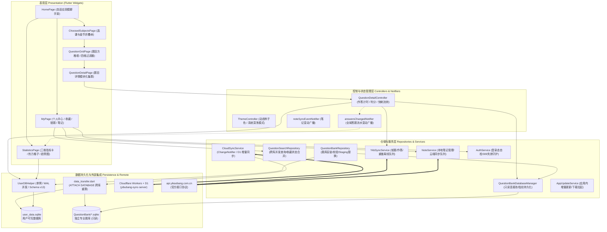

> 历史快照：归档于2026-11-13，包含各阶段当时状态。当前状态见[开发状态](../../antigravity/DEVELOPMENT_STATUS.md)，不要据本文旧版本/未提交描述判断当前实现。

# ARCHITECTURE.md - 医不帮系统整体架构与调用链规范

> **题库专项当前基线**：093f4ef；用户库 v13，题库 schema v1；2026-11-07。
> **历史审计基线**：3c33fb9；正文历史背景保留，题库订阅当前责任分层见文末。

---

## 1. 系统总体层次架构

系统由四个核心逻辑分层构成：



---

## 2. 应用初始化与生命周期流程

应用启动入口定义于 [`lib/main.dart`](../../../lib/main.dart#L22-L79)：

```mermaid
sequenceDiagram
    autonumber
    participant Main as main()
    participant Prefs as initSettings()
    participant Theme as ThemeController
    participant App as runApp(Yibubang)
    participant BG as 后台异步守护 _initializeQuestionBank()
    participant Repo as QuestionBankRepository
    participant Cloud as CloudSyncService
    participant Queue as YkbSyncService / NoteService
    participant Auth as AuthService

    Main->>Main: WidgetsFlutterBinding.ensureInitialized()
    Main->>Main: 平台数据库工厂初始化 (Web: ffiWeb; Linux/Mac/Win: ffi)
    Main->>Main: 沉浸式透明小白条设置 (SystemChrome.edgeToEdge)
    Main->>Prefs: await initSettings() (预埋各全局默认值)
    Main->>Theme: await recoverTheme() (恢复种子色与深浅模式)
    Main->>App: runApp(const Yibubang()) (渲染首帧，绝不阻塞)

    par 异步静默后台守护 (unawaited)
        Main->>BG: _initializeQuestionBank()
        BG->>Repo: await QuestionBankRepository().initialize() (题库指纹自检)
        BG->>Cloud: await CloudSyncService.init()
        opt autoSync 开启
            BG->>Cloud: unawaited(sync()) (静默增量拉取/推送)
        end
        BG->>Queue: unawaited(processQueue()) (离线队列自动上报)
        BG->>Auth: unawaited(checkTokenValidity(promptRelogin: true)) (自检Token)
    end
```

---

## 3. UI 表现层与自适应路由架构

### 3.1 桌面端与移动端双模分流 (`lib/common/platform_adaptive.dart`)
- **断点判定**：`isDesktopLayout(context)`：
  - macOS / Windows / Linux 平台且窗口宽度 >= 640px 触发桌面布局；
  - 平板设备宽度 >= 840px 触发宽屏布局；其余情况保持移动端布局。
- **导航架构 (`lib/screens/home_page.dart`)**：
  - **桌面端**：左侧 `NavigationRail` + `VerticalDivider` + `IndexedStack` 瞬时切换 Tab（避免宽屏滑动手势异常与布局拉伸）。
  - **移动端**：底部 `NavigationBar` + `PageView`（支持横向滑动手势转场与动画时长定制）。

### 3.2 自适应模态弹出机制 (`pushAdaptiveModalPage`)
针对登录、选课、题库管理、刷题流水记录、设置及笔记等独立功能页：
- **移动端**：走原生路由栈全屏推入 (`adaptivePageRoute`)。
- **桌面端**：封装为居中卡片式浮窗 (`Dialog`)，限定最大宽度（620px~760px），内部注入 `_AdaptiveModalContainer` 与专用嵌套 Navigator。
- **内置嵌套路由**：在模态窗口内部跳转子页面（例如：设置 -> 主题颜色、我的笔记 -> 查看原题），直接在窗内内置路由平滑切页，具有返回按钮回到上级，保持层级关系，不再堆叠多个全屏弹窗。

---

## 4. 关键业务调用链与数据流追踪

### 4.1 用户作答与流水落库链
用户在刷题页选择选项并提交时：
1. **触发入口**：[`lib/screens/question_detail/question_options_view.dart:133`](../../../lib/screens/question_detail/question_options_view.dart#L133) 单选变更或多选提交。
2. **逻辑控制器**：[`lib/screens/question_detail/question_detail_controller.dart:159`](../../../lib/screens/question_detail/question_detail_controller.dart#L159) 执行 `submitAnswer`：
   - 计算思考时长：`elapsedMs = DateTime.now().millisecondsSinceEpoch - pageOpenedAt`；
   - 答案排序与对错比对：`sortString(userAnswer) == sortString(question.answer)`；
   - 更新内存状态：`userQuestion.status = 1 (正确) / 2 (错误)`；
   - 快刷模式联动：若回答正确且处于快刷模式，调用 `nextPage()`。
3. **数据访问层**：[`lib/models/question.dart:454`](../../../lib/models/question.dart#L454) 执行 `updateQuestion`：
   - 打开题库查询关联的 `IdentityQuestion`（确定所属 `identity_id`、`subject_id`、`chapter_id`）；
   - 在 `user_data.sqlite` 中执行 `UPSERT` 事务，原子增减 `IdentitySubject` 与 `IdentityChapter` 的 `correct` / `incorrect` 计数；
   - 更新 `Question` 表的 `user_answer`, `status`, `updated_at`；
   - 向 `Activities` 插入单条作答事件记录（包含 `duration` 毫秒、时间戳、题库 ID、对错状态）；
   - 调用 `notifyAnswersChanged()`，触发全局统计刷新广播；
   - 异步将作答事件推入 `YkbSyncService.instance.syncAnswer` 离线队列。

### 4.2 跨库题目全量检索调用链
1. **触发入口**：[`lib/screens/search_page.dart:140`](../../../lib/screens/search_page.dart#L140)。
2. **仓储调度**：[`lib/repositories/question_search_repository.dart:142`](../../../lib/repositories/question_search_repository.dart#L142) `loadPage`：
   - 遍历所有启用且已安装的只读题库（排除 `legacy_combined`）；
   - 对每个题库并发执行分页查询：`WHERE title LIKE ? OR public_title LIKE ? OR option LIKE ? OR explain LIKE ? LIMIT 80 OFFSET ?`；
   - 批量汇总命中的 `chapter_parent_id`，查询 `Subject` 表补齐课程中文名称；
   - 将所有命中的 `questionId` 归集，批量查询 `user_data.sqlite` 中的 `Question` 表，补充用户收藏与已斩状态；
   - 将组装完成的结果集分页流式交回前端展示。

### 4.3 题库安全下载与原子替换安装链
1. **触发入口**：[`lib/screens/question_bank_page.dart:180`](../../../lib/screens/question_bank_page.dart#L180)。
2. **仓储执行**：[`lib/repositories/question_bank_repository.dart:550`](../../../lib/repositories/question_bank_repository.dart#L550) `downloadAndInstall`：
   - 启用流式 HTTP 下载并实时汇报百分比进度；
   - 下载至临时文件后比对 SHA-256 散列；
   - 提取并暂存至目标目录 `$bankId.sqlite.staging`；
   - 调用 `validatePath` 执行 5 重完整性与元数据校验（表结构、`schema_version`、`BankMeta` 统计数、`PRAGMA integrity_check`、外键引用）；
   - 校验通过后，将现有旧题库重命名为备份文件 `$bankId.sqlite.bak`；
   - 将 staging 原子重命名为正式题库文件 `$bankId.sqlite`；
   - 向 `user_data.sqlite` 的 `QuestionBank` 目录表更新版本与元数据记录；
   - 若替换过程发生任何异常，自动从 `.bak` 回滚还原。

---

## 5. 存储架构与数据表定义

### 5.1 用户数据库 `user_data.sqlite` (Schema Version 12)
管理类为 [`UserDBHelper`](../../../lib/db/database_helper.dart#L211-L408)：

| 表名 | 角色与用途 | 主键及关键约束 | 核心字段说明 |
| :--- | :--- | :--- | :--- |
| `Question` | 全局题目作答状态 | `id TEXT PRIMARY KEY` | `cut_question` ('1'/'0'), `user_answer`, `status` (0未做,1对,2错,4待交), `collection`, `updated_at` |
| `Activities` | 作答明细事件溯源流水 | `id TEXT PRIMARY KEY` | `bank_id`, `question_id`, `identity_id`, `subject_id`, `chapter_id`, `is_right`, `duration` (毫秒), `timestamp` |
| `QuestionBank` | 本地题库注册目录 | `bank_id TEXT PRIMARY KEY`| `name`, `version`, `schema_version`, `local_path`, `content_hash`, `size`, `enabled`, `built_in`, `update_enabled` |
| `IdentitySubject` | 分题库课程进度统计 | `PRIMARY KEY (bank_id, identity_id, subject_id)` | `correct` (累计做对数), `incorrect` (累计做错数), `selected` (是否选修) |
| `IdentityChapter` | 分题库章节进度统计 | `PRIMARY KEY (bank_id, identity_id, subject_id, chapter_id)` | `correct`, `incorrect` |
| `Notes` | 用户本地题目笔记 | `id TEXT PRIMARY KEY` | `remote_id`, `question_id`, `content`, `imgs` (JSON), `timestamp`, `updated_at`, `sync_status` |
| `NoteSyncQueue` | 笔记离线同步队列 | `id TEXT PRIMARY KEY` | `action` ('upload'/'delete'), `note_id`, `question_id`, `payload`, `retry_count`, `last_error`, `last_response` |
| `YkbSyncQueue` | 医考帮离线同步队列 | `id TEXT PRIMARY KEY` | `type` ('cut'/'answer'/'redo_chapter'), `item_id`, `payload`, `retry_count`, `last_error`, `last_response` |
| `MigrationState` | 迁移状态机追踪表 | `migration_id TEXT PRIMARY KEY` | `from_version`, `to_version`, `state`, `started_at`, `finished_at`, `error` |
| `Cards` | 历史僵尸表（待清理） | `id TEXT PRIMARY KEY` | `front`, `back`, `timestamp` (无业务使用) |

### 5.2 独立专业题库 `QuestionBank/<bank_id>/<bank_id>.sqlite` (只读)
由 [`QuestionBankDatabaseManager`](../../../lib/db/question_bank_manager.dart#L11-L60) 只读打开：

| 表名 | 角色与内容 |
| :--- | :--- |
| `BankMeta` | 题库元数据（`bank_id`, `name`, `version`, `schema_version`, `question_count`, `subject_count`, `chapter_count`） |
| `Identity` | 专业身份层级结构（例如口腔专科 `30401`） |
| `Subject` | 课程列表（例如解剖生理学、口腔组织病理学） |
| `Chapter` | 章节树结构 |
| `Question` | 题目静态内容（题干、题型、年份、选项、答案、解析、配图） |
| `IdentitySubject` | 题库内置的初始专业-课程对应表 |
| `IdentityChapter` | 题库内置的初始专业-章节对应表 |
| `IdentityQuestion` | **题库唯一的权威关系网**（维护每一道题目精确隶属于哪个 `identity`、`subject`、`chapter`） |

---

## 6. 跨平台特化实现矩阵

| 平台 | 数据库驱动 | 存储路径策略 | 文件选择与保存方案 | 权限与签名配置 |
| :--- | :--- | :--- | :--- | :--- |
| **Android** | `sqflite` (JNI 原生驱动) | 内部沙盒 `/data/data/.../databases/` | 导出走外部存储目录，安装走 `open_filex` 意图 | 需 `MANAGE_EXTERNAL_STORAGE`、`REQUEST_INSTALL_PACKAGES`；Debug Keystore 签名 |
| **macOS** | `sqflite_common_ffi` | `~/Library/Containers/.../Data/Documents/` | `FilePicker.saveFile` 仅返回路径，Dart 自行写入字节 | 沙盒配置 `com.apple.security.network.client` 与 `files.user-selected.read-write` |
| **Windows** | `sqflite_common_ffi` | `C:\Users\<user>\AppData\Roaming\...` | `FilePicker.saveFile` 返回目标路径后自行写入 | 便携 ZIP 绿色版，无特殊权限限制 |
| **Linux** | `sqflite_common_ffi` | `~/.local/share/...` | `FilePicker.saveFile` 返回目标路径后自行写入 | GTK 原生支持，依赖 libsqlite3 |
| **iOS** | `sqflite` (原生驱动) | 沙盒应用文档目录 (`Documents/`) | 移动端原生文档共享，图片走相册读取 | ATS HTTPS 强制加密，需适配相册读取权限 |

---

## 7. 系统三大“同步”核心边界与隔离矩阵

医不帮系统内部存在三套完全独立、服务于不同维度的“同步”机制，严禁混淆概念与共享配置键：

| 维度 | 同步 1：题库内容同步 (题库源) | 同步 2：医考帮账号业务同步 (官方互动) | 同步 3：医不帮多端增量同步 (多端漫游) |
| :--- | :--- | :--- | :--- |
| **同步本质** | 医考帮官方题库 -> 医不帮题库（**知识库拉取**） | 医不帮 <-> 医考帮官方个人账号（**个人业务双向**） | 医不帮设备 A <-> 医不帮设备 B（**跨设备数据漫游**） |
| **传输数据** | 题目、科目、章节、题干解析、选项、标准答案（只读公共数据） | 做题记录对错、斩题状态、用户笔记（含图片）、章节重做 | 题目对错与选答、做题微秒级流水（`Activities`）、耗时（`duration`）、做题模式、自建笔记 |
| **物理存储** | `QuestionBank/<bank_id>/<bank_id>.sqlite`（物理只读） | `user_data.sqlite`（`Question`, `Notes`, `YkbSyncQueue`） | `user_data.sqlite`（全量用户记录增量合并） |
| **操作影响** | **绝对不包含**用户作答历史；仅写暂存题库副本，正式文件只读并原子替换 | **绝对禁止写题库文件**；上行加入队列，下行拉取更新用户库 | **绝对不触碰题库文件**；只对用户库根据时间戳与版本增量合并 |
| **核心服务** | `YkbBankSmartSyncService` (增量), `YkbBankSyncService` (全量) | `YkbSyncService` (上行), `YkbPullService` (下行), `NoteService` | `CloudSyncService` (D1 云端), `RecordSyncService` (ZIP 导入导出) |
| **专用配置键**| `sync_bank_smart_enabled` (智能增量开关)<br>`bank_manifest_auto_refresh` (题库页刷新) | `sync_answers_to_ykb`, `sync_cut_to_ykb`, `sync_notes_to_ykb`, `sync_redo_to_ykb`, `sync_ykb_progress_enabled` | `cloud_sync_auto`, `cloud_sync_pairing_code`, `cloud_sync_server_url` |
| **触发时机** | 后台静默续传、课程页「智能增量/全量重建」按钮 | 用户作答即时上报、启动后静默拉取、课程页「拉取记录」按钮 | 用户作答后自动云同步（可选）、云同步页面手动触发、ZIP 导入导出 |


## 题库专项架构增补（2026-11-07，统一方案之前的历史记录）

BankCreationService 编排递归完整构建，复用 YkbBankSyncService 的 schema/解密/字段转换。syncBank 全量重建也复用构建器；完整树库的智能入口在 YkbBankSmartSyncService 内构建完整快照再合并，原有旧库保持章节映射算法。只修改暂存文件，正式库始终只读。

用户库 v12 新增 BankHistory。QuestionBankRepository 安装在用户选择前互斥，登记、履历、SQLite ATTACH 重算同一事务，异常恢复旧文件。rebuildAttachedQuestionCount 复用原统计 SQL；原 rebuildQuestionCount 外部入口仍保留。

BankSubscriptionService 管理 HTTPS JSON 清单与六小时应用内计时器；其配置与 API 内容同步、个人记录上传、漫游独立。BankDetailPage 读取内容和用户履历；BankExportService 在副本中清理账号值后导出，移动用系统文档 API，桌面先验证目的路径再复制。

## 2026-11-07 用户反馈架构增补（统一方案之前的历史记录）

BankSubscriptionLoader 按文件头识别 JSON/ZIP/SQLite，先校验再登记。BankSubscriptionSettings 独立配置应用内检查间隔；单库手动更新在 BankSubscriptionService.refresh(bankId, installUpdates) 中刷新来源、安装并重算，重复无变化不生成履历。BankCreationReport 编排本次多库错误策略与报告；只有显式传交互处理器的创建允许跳过失败章节，默认构建/同步仍严格。BankExportButton 在管理与详情共用导出流程，保持正式库只读。

## 统一管理方案当前责任分层（2026-11-07）

- BankSourceStore：SharedPreferences 中的来源目录、主来源绑定、待验证候选与归档；序列化配置变更，兼容旧来源缓存迁移。
- BankSubscriptionService：保存配置、检查、确认下载、切换来源、安装任务与独立自动计时器。check(bankId/sourceId) 只改变检查范围，均不安装；addSource/editSource/proposeBankSource 不联网。ChangeNotifier 推送检查/安装结果至管理、详情和来源页。
- BankSubscriptionLoader：JSON 小型清单/HTTP 条件请求与 HEAD 探测；不能轻量确定的文件直链返回 needsDownload。load 为显式下载与严格识别/校验；GitHub 代理实际传输地址与 HTTP 验证器一起保存，不跨传输源复用。
- BankArtifactCache：可写 BankDownloads 目录，默认 256 MiB；摘要复核、LRU、活动 lease 和取消清理。同一安装任务贯穿确认/比较/安装持有 lease，下载包不被提前淘汰。
- 用户库 v13 BankContentState：已处理上游发布、来源/摘要/版本与本地修订/已安装摘要分离。QuestionBankRepository 的暂存安装将目录、基线、BankHistory 与 ATTACH 重算放同一用户库事务，失败恢复旧文件。
- QuestionBankFileService.diff/merge：用原生 SQLite ATTACH 计算新增、内容不同和本地独有题目，并在新暂存文件合并。同题原始全局 id 保持，正式库连接 readOnly。
- BankDownloadTask / BankActionButton / BankActionProgress：阶段、字节、取消；进入原子安装后禁取消。BankUpdateInfo 负责检测状态，和是否允许自动安装独立。
- UI：项目 InfoCard/TileIcon、主题颜色/字体/形状、760px 内容宽度，只有一个状态驱动的检查/下载确认/更新主动作；完整性和重新下载在详情更多菜单，候选来源须显式选择。
- API 抓题与个人记录/多设备漫游保持独立。旧 BankSubscriptionService.refresh / setBankSource 以及仓储 checkRemoteManifest / downloadBank / hasUpdate 已移除，历史增补中的旧调用不再是当前入口。

配置键 bank_subscription_auto、bank_subscription_auto_install、bank_subscription_interval_minutes 分别控制检查、安装与间隔；默认仅手动检查，开启自动检查后也不默认自动安装。计时器仅应用运行期间生效。全套 113/113 自动化测试通过，真实账号/原生文件选择器待实机验收。

## 2026-11-07 操作进度呈现增补

BankActionButton 绑定 BankDownloadTask，通过 ListenableBuilder 在发起按钮原位呈现圆形字节进度；检查等无总量操作使用不确定圆环，取消仍走任务自身的安装保护。BankProgressView 保留创建/同步的状态与章题计数，创建页通过 showIndicator=false 避免重复圆环。详情三项统计来自只读题库元数据，旧合并库只读 SQL COUNT。管理卡片导航与 selectBank 独立，所有题库/用户库架构契约不变。


## 2026-11-07 追加六项需求：切片 B（创建确认与学科树，完成）

- “开始创建”先显示 Material 确认框，说明自动抓取的著作权/服务协议/法律责任和会员/课程权限不足导致失败（203）。必须勾选已了解风险并确认当前账号会员与访问权限，才能“确认并开始”；取消或关闭不创建报告、不请求题库内容。会员/权限是用户确认，未声称通过 API 验证；原 203 错误选择和结果报告保持。
- 新 BankIdentityTree 选父节点递归勾选全部后代；取消部分后代时祖先为 null 半选，点击半选父节点补齐，点击全选父节点清空子树；子节点全部选中时自动归并父节点。沿用 BankIdentityNode.selectedRoots，半选父节点不会把取消的后代传给抓取器，完全选中的父子不重复建库。
- 学科名称与数字 ID 小圆角 Chip 同行；层级缩进、折叠状态和选择独立，去除展开时的深色边线，创建页最大 760px 与其他管理页一致。
- 验证：flutter analyze --no-pub 0 issues；flutter test --no-pub 133/133。新增取消确认零请求 2 项、三层学科树联动/半选/折叠后保留/补齐/全清/去重/标签同行 2 项；原创建→确认→203 忽略/忽略全部/终止→报告真实 SQLite 流程均通过。390px/1000px 真实字体与 MaterialIcons 临时截图探针额外 2/2，并已人工复核；临时脚本已清理。
- 本次第 1～6 项全部完成；切片 A 为 032c2ea（129/129），切片 B 为 2ea7e79（133/133），不 push。真实账号会员/课程权限现场和原生文件选择器继续待实机验收。题库 schema v1、用户库 v13、正式库只读、全局 question_id 和 ATTACH 契约保持。
- 下一会话：先核对最新 Git/基线/本交接，按用户反馈做视觉或真实账号验收，不重做已完成模块。


## 2026-11-07 创建学科树性能分层

BankIdentitySelection 首次索引父子关系与可选叶数，维护每节点三态 ValueNotifier；勾选仅更新子树与祖先。BankIdentityTree 将展开节点扁平化，用 ListView.builder 懒加载可见行；折叠后代不挂载，选择保存在模型。BankCreationPage 的 onChanged 仅更新选择集合和开始按钮 ValueNotifier，避免整页 setState。selectedRoots 仅在开始创建时调用，抓取服务与原始题目 ID/只读/ATTACH 契约不变。全局检查入口集中 BankSubscriptionsPage._checkAll，管理卡片仍调用相同 check 服务处理单库。
