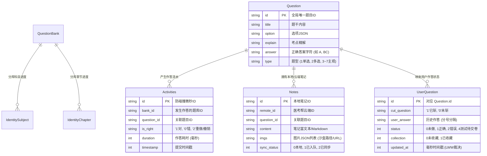

> 历史快照：归档于2026-11-13，包含各阶段当时状态。当前状态见[开发状态](../../antigravity/DEVELOPMENT_STATUS.md)，不要据本文旧版本/未提交描述判断当前实现。

# PROJECT_MEMORY.md - 医不帮 (yibubang) 长期技术记忆与系统事实

> **文档性质**：持久化核心事实源（不可随意变更）
> **生效版本**：v2.0.5+205（基准 Commit: `3c33fb9`）
> **基准日期**：2026-10-31

---

## 1. 项目定位与核心价值

- **项目全称**：医不帮 (Yibubang)
- **核心定位**：专为医学生打造的现代化、离线优先（Offline-First）、跨平台医学刷题与复习利器。
- **目标受众**：医学院校在校生、考研医学生、执业医师/助理执业医师/护理资格考试考生。
- **核心痛点解决**：
  1. 官方正版医学刷题 App 强制要求实时联网，地铁、教室地下室网络差时加载极为缓慢。
  2. 启动广告严重、强制搜集隐私、商业捆绑推广频繁。
  3. 缺乏真正适配桌面大屏（Windows/macOS/Linux）的原生软件，备考体验割裂。
  4. 刷题软件强行绑定私有格式，用户作答记录、做题用时无法长期自主掌握。

---

## 2. 核心技术栈与运行环境

| 层次 | 选型与版本 | 职责与设计依据 |
| :--- | :--- | :--- |
| **基础语言与引擎** | Flutter 3.32.0+ / Dart 3.8.0+ | 跨平台渲染基座，全平台统一 Dart 代码与 Material 3 视觉系统 |
| **本地数据库引擎** | SQLite 3 (sqflite / sqflite_common_ffi) | 桌面端（macOS/Win/Linux）走 FFI，移动端走原生平台引擎，默认开启 WAL 并发模式 |
| **自研云端同步** | Cloudflare Workers + D1 数据库 (`yibubang-sync-server`) | TypeScript + Hono 构建，以毫秒级 `updated_at` + LWW 算法实现轻量多端增量互相同步 |
| **外部生态接口** | 医考帮官方 HTTP 接口逆向协议 | DES 加密密码、动态 MD5/SHA1 签名与自检队列，拉取官方评论区与双向同步斩题/笔记 |
| **图表可视化** | `fl_chart: ^0.70.2` | 渲染刷题趋势图、双Y轴时长与题量统计曲线 |
| **图片离线缓存** | `cached_network_image: ^3.4.1` (配合自研 `AppNetworkImage`) | 内存与磁盘双重缓存，保障断网离线刷题时解剖图、病理图正常展示 |

---

## 3. 不可逾越的核心架构铁律 (Architectural Invariants)

### 3.1 物理读写分离原则 (Physical Separation of Concerns)
- **题库只读（Read-Only Content）**：所有独立题库（`QuestionBank/<bank_id>/<bank_id>.sqlite`）在客户端**一律只读打开（`readOnly: true, singleInstance: false`）**。更新时采用“全量文件替换”策略。禁止任何向题库文件写入数据的操作。
- **用户数据专属可写（Writable User State）**：用户所有答题结果、历史答案、收藏、斩题、毫秒级耗时（`duration`）、作答流水（`Activities`）与笔记一律写入 `user_data.sqlite`（Schema Version 10）。

### 3.2 全局 `question_id` 契约 (Global Question Identity)
- 题目（Question）是跨题库共享的全局唯一实体，`question_id` 在全系统全局稳定。
- 同一道题目若同时存在于不同题库（例如临床期末与临床执业医师），用户在任一题库作答或收藏后，切换题库自动互通，用户状态绝不割裂。
- `user_data.sqlite` 中的 `Question` 表主键必须且只能是单列 `id`，禁止加入 `bank_id` 联合主键。

### 3.3 题库隔离与统计重算契约 (ATTACH Database)
- `bank_id` 仅用于分题库的目录注册、物理路径隔离和分库课程章节进度（`IdentitySubject`、`IdentityChapter`）。
- 统计重算必须遵循 SQLite 原生 `ATTACH DATABASE` 规范（参考 `lib/db/data_transfer.dart` 中的 `rebuildQuestionCount`），在毫秒级内完成数十万道题目的跨库聚合与进度自愈，严禁在 Dart 内存中进行低效拼接。

### 3.4 启动性能铁律：文件指纹持久化加速 (Validation Cache)
- 在移动端冷启动时，禁止每次打开题库都执行扫描全库的 `PRAGMA integrity_check`（30MB~176MB 文件全表扫描耗时高达 2~5 秒）。
- 首次全量校验通过后，必须将 `size:modifiedMilliseconds` 指纹持久化于本地。二次启动只要文件指纹未变，直接命中缓存跳过全库扫描，确保冷启动延迟低于 5 毫秒。

### 3.5 离线优先与网络静默守护 (Offline-First Resiliency)
- 用户的任何单题作答、斩题或笔记保存，必须**先完成本地 SQLite 事务落盘**，再异步入队（`YkbSyncQueue` / `NoteSyncQueue`）。
- 网络异常或 Token 过期不得阻断任何本地刷题流程。

---

## 4. 核心数据模型与概念实体

---

## 5. 跨平台开发核心约束与禁忌

1. **绝对禁止硬编码绝对路径与路径分隔符**：
   - 必须统一使用 `getDatabasesPath()`、`getApplicationDocumentsDirectory()` 配合 `path` 包的 `p.join(...)`。
2. **桌面端与移动端弹窗规范**：
   - 模态弹出必须使用 `showAdaptiveModalSheet` 或 `pushAdaptiveModalPage`：桌面宽屏渲染为居中卡片 Dialog，手机端渲染为 BottomSheet。
   - 必须保持桌面端嵌套模态路由内部的 Navigator 状态自闭合，并向外层正确回传关闭结果。
3. **不可破坏已修复的防碰撞主键算法**：
   - `generateSimpleId()` 结合了微秒级时间戳、3位进程内自增序数与6位加密随机数，严禁回退为单纯的微秒取模算法。
