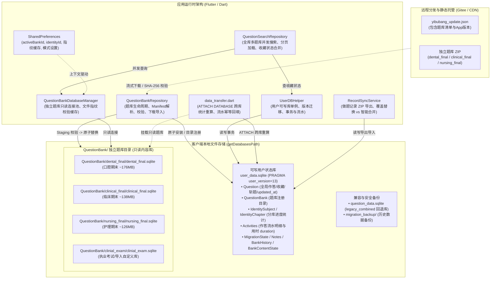
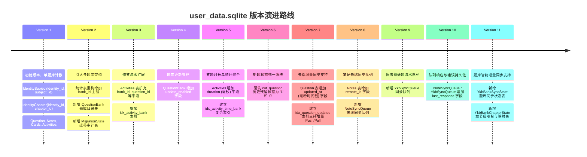
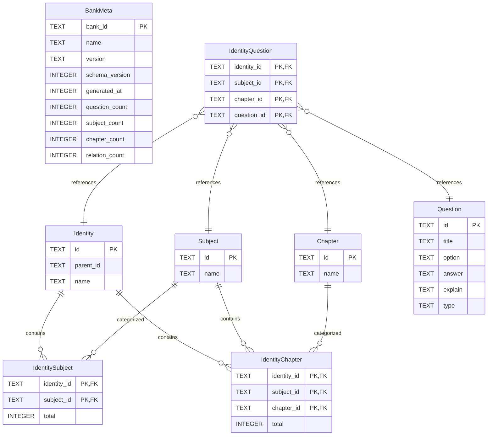
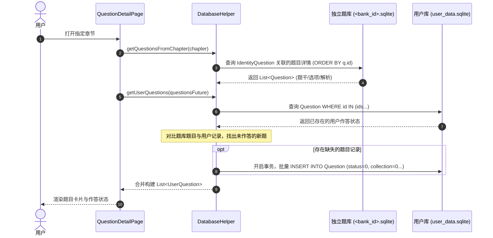
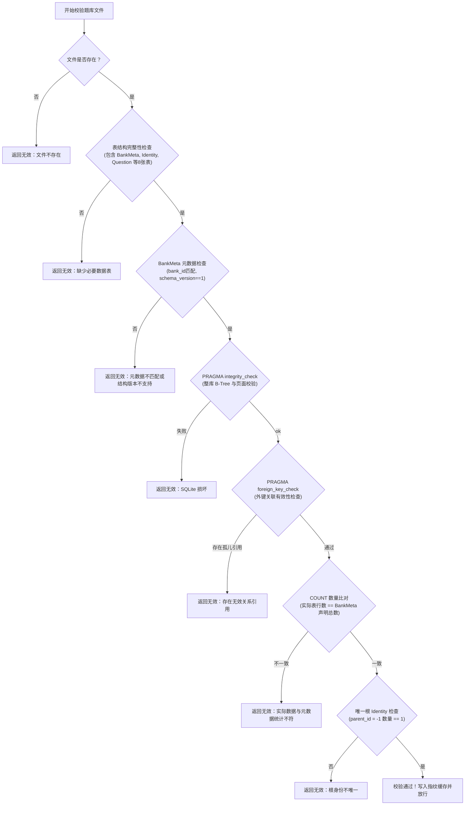
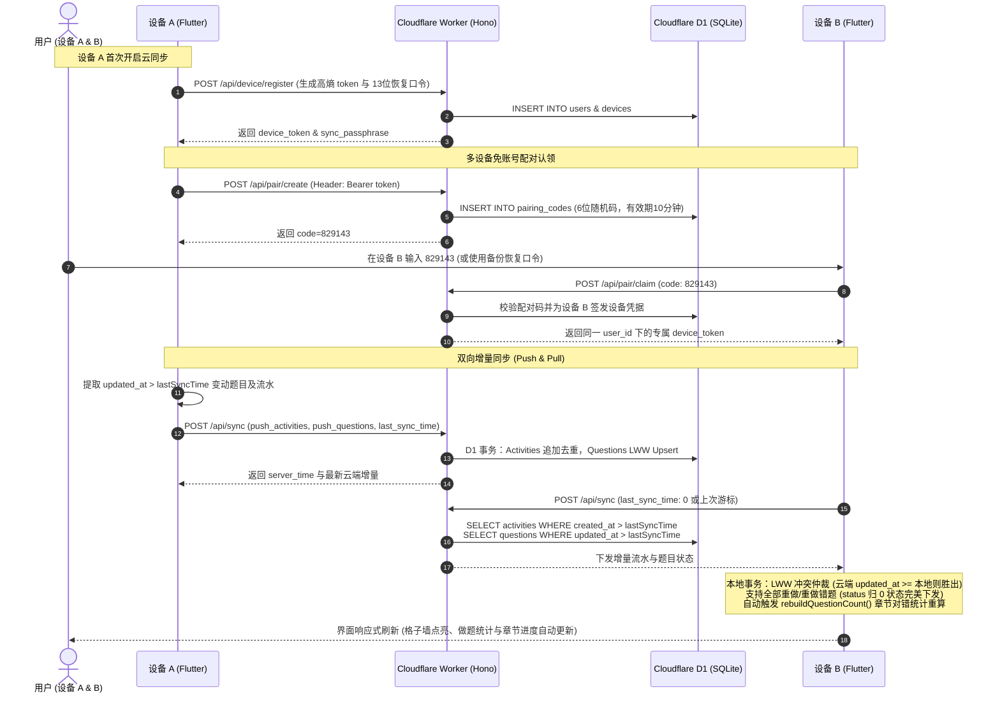

> 历史快照：归档于2026-11-13，包含各阶段当时状态。当前状态见[开发状态](../../antigravity/DEVELOPMENT_STATUS.md)，不要据本文旧版本/未提交描述判断当前实现。

# 医不帮 (yibubang) 数据库架构与详细设计说明书 (当前版本)

> **文档状态**：当前生效版本（Current Implementation）；题库统一管理 Commit f011283，用户库 v13 / 题库 schema v1（2026-11-07）。
> **基准代码**：`yibubang` 客户端当前代码库（`lib/`）及数据生产端（`docs/yikaobang/`）
> **数据文件**：`docs/yikaobang/data/`、`docs/yikaobang/data/question_banks/`
> **演进参考**：前期调研与升级方案详见 [docs/gpt/database_research.md](../codex/database_research.md)、[docs/gpt/upgrade_database.md](../codex/upgrade_database.md) 与 [docs/gpt/database_updated.md](../codex/database_updated.md)

---

## 1. 架构总体概述 (Executive Summary)

### 1.1 演进背景与设计目标
在早期的单体架构中，整个系统的题目、专业层级、课程、章节、评论以及初始答题字段全部集中打包在一个庞大的单体 SQLite 数据库（`question_data.sqlite`，解压后约 287MB，包含 14.2 万道题目）。随着题库规模扩大，该设计暴露出多项结构性瓶颈：
1. **全量更新代价极高**：任意专业哪怕只修改一道错别字，客户端也必须重新下载并解压接近 60MB 的 ZIP 压缩包；
2. **多题库无法独立交付**：口腔、临床、护理等不同考试方向强行糅合在一起，不支持按需下载、启用、禁用与更新；
3. **用户数据与题库内容耦合风险**：早期的用户作答数据与只读题库数据边界不清，题库重刷或更新时极易污染甚至覆盖用户历史进度。

为此，当前系统实施了彻底的**“多题库拆分 + 全局共享用户状态”**架构演进，确立了如下核心设计理念：



### 1.2 六大核心设计原则
1. **内容只读与用户可写物理分离**：
   - 所有独立题库文件（`<bank_id>.sqlite`）在客户端**仅以只读模式（`readOnly: true`）打开**，题库更新直接采用“全量文件替换”策略；
   - 用户的所有答题结果、历史答案、对错状态、收藏、斩题、做题耗时、做题流水等一律写入独立的 `user_data.sqlite`。
2. **全局 `question_id` 契约与跨题库共享实体**：
   - 题目（Question）是跨题库共享的唯一实体，`question_id` 全局稳定且唯一；
   - 同一道题若出现在多个题库（例如临床期末与临床执业考试），用户在任一题库作答后，切换到其他题库时**自动共享同一份作答与收藏状态**，无需重复刷题。
3. **`bank_id` 作为题库维度隔离边界**：
   - `bank_id` 仅用于题库目录记录（`QuestionBank`）、题库物理路径、下载与版本校验、分题库的课程与章节统计（`IdentitySubject`、`IdentityChapter`）以及作答流水上下文（`Activities.bank_id`）；
   - `bank_id` 绝不加入用户题目状态（`Question.id`）的主键，确保共享逻辑天然成立。
4. **高韧性兼容与终极回退机制**：
   - 老用户的旧版单体题库 `question_data.sqlite` 不在升级时物理删除，而是作为 `legacy_combined` 题库登记进本地目录；
   - 当新版独立题库校验失败或文件缺失时，系统可无缝回退至旧版题库，保障老用户刷题功能始终可用。
5. **从单纯计数演进为精细化作答流水与用时统计**：
   - 数据库版本升级至 `v5`，在 `Activities` 流水中补充记录做题耗时（`duration` 毫秒级）、作答时间戳、所属题库、题目、专业、课程、章节及正误状态；
   - 建立复合索引 `idx_activity_time_bank`，原生支持按日、按周、按月以及分题库的高性能刷题时长与正确率多维聚合。
6. **跨端备份与做题记录智能合并**：
   - 提供 `RecordSyncService`，支持将 `user_data.sqlite` 打包压缩为 ZIP 文件进行多端搬运；
   - 导入时不仅支持直接“覆盖替换”，更支持独创的“智能合并（Merge）”算法：本地优先、状态补充、收藏与斩题取并集、流水去重追加。

---

## 2. 存储体系与物理布局设计 (Physical Storage Layout)

### 2.1 生产端与工程目录布局 (`docs/yikaobang/data/`)
工程源码及数据生产工具位于 `docs/yikaobang/`，产物目录结构如下：

```text
docs/yikaobang/
├── src/
│   ├── spider.py                  # API 爬虫：登录、签名、DES 解密、抓取题目与章节
│   ├── encrypt.py                 # 加密/签名实现（DES-CBC、MD5、时间戳）
│   ├── save_data.py               # 历史生成工具：将清洗后的 JSON 导入合并题库
│   └── split_question_banks.py    # 题库拆分核心工具：按 IdentityQuestion 关系拆分多题库
└── data/
    ├── question_data.sqlite       # 旧版单体合并题库（只读兼容产物，~287MB）
    ├── question_data.sqlite.zip   # 旧版单体合并题库压缩包（~55.5MB）
    └── question_banks/            # 新版拆分题库根目录
        ├── manifest.json          # 本地题库清单元数据（三套官方题库的版本与散列）
        ├── user_data.sqlite       # 开发/测试运行时的用户状态数据库样例（~245KB）
        ├── dental_final/          # 口腔期末
        │   ├── dental_final.sqlite      # SQLite 题库文件（~176MB）
        │   └── dental_final.sqlite.zip  # 压缩交付包（~32.5MB）
        ├── clinical_final/        # 临床期末
        │   ├── clinical_final.sqlite    # SQLite 题库文件（~138MB）
        │   └── clinical_final.sqlite.zip# 压缩交付包（~25.9MB）
        ├── nursing_final/         # 护理期末
        │   ├── nursing_final.sqlite     # SQLite 题库文件（~126MB）
        │   └── nursing_final.sqlite.zip # 压缩交付包（~24.1MB）
        └── clinial_exam/          # 临床执业资格考试（自定义/扩展题库）
            ├── clinial_exam.sqlite      # SQLite 题库文件（~57MB）
            └── clinial_exam.sqlite.zip  # 压缩交付包（~12MB）
```

### 2.2 客户端运行时物理路径 (`<databasesPath>`)
客户端通过 `sqflite` 的 `getDatabasesPath()` 获取各平台（Android、iOS、macOS、Windows、Linux）专属的数据库存储目录，其规范化结构如下：

| 文件 / 目录相对路径 | 角色与用途 | 读写权限 | 生命周期与清理策略 |
| :--- | :--- | :--- | :--- |
| `user_data.sqlite` | 用户核心状态数据库（版本 12） | 读写 | 永久保留；导出导入覆盖前需关闭连接 |
| `user_data.sqlite-wal` / `-shm` | SQLite WAL 模式临时日志文件 | 读写 | 由 SQLite 引擎自动管理；替换覆盖前需显式删除 |
| `question_data.sqlite` | 旧版合并题库文件（降级兼容库） | 只读 | 升级老用户保留；新安装用户不强制下载 |
| `migration_backup/` | 升级初期的容灾备份目录 | 只读备份 | 初始化首次将老库拷贝至此，防止极端异常破坏数据 |
| `QuestionBank/` | 拆分题库根目录 | 只读存放 | 由系统统一管理，禁止页面硬编码拼接路径 |
| `QuestionBank/<bank_id>/<bank_id>.sqlite` | 独立题库正式数据库文件 | 只读 | 正式题库；更新时由 staging 原子替换 |
| `QuestionBank/<bank_id>/<bank_id>.sqlite.bak` | 题库更新前的安全备份文件 | 只读备份 | 更新发生前创建；更新失败时自动回滚恢复 |
| `QuestionBank/<bank_id>/<bank_id>.sqlite.staging` | 题库更新写入中的暂存文件 | 写入中 | 下载/解压写入中；校验通过后重命名为正式文件 |
| `QuestionBank/.download-*.zip/.sqlite` | 远程下载中的临时流式文件 | 临时 | 下载完成后校验哈希，解压后立即物理删除 |
| `QuestionBank/.import-*.sqlite` | 本地 ZIP 导入解压出的临时库 | 临时 | 提取后校验元数据，安装完成后物理删除 |

### 2.3 并发连接与生命周期管理
系统对不同类型数据库实施差异化连接策略：
- **`UserDBHelper`（用户库连接单例）**：
  - 维护单一连接实例 `_database`；
  - 开启 WAL 模式提高并发性能；
  - 提供 `close()` 方法：在执行“导出记录读取字节”或“导入记录文件覆盖”之前，必须显式调用 `close()`，确保 WAL/journal 完全落盘，并彻底释放文件句柄。
- **`QuestionBankDatabaseManager`（独立题库只读连接池）**：
  - 内部使用 `Map<String, Database> _databases` 维护各题库的只读连接；
  - 打开参数设置 `readOnly: true, singleInstance: false`；
  - 避免多页面重复打开造成句柄泄露，切换题库或更新题库时显式调用 `closeBank(bankId)` 关闭旧连接；
  - **避坑实践**：sqflite 打开只读数据库时，`rawQuery` 返回的行对象为不可变（Unmodifiable）集合，代码在合并用户统计数据时显式拷贝为可变 List（例如 `[...initialMainRows]`）。

---

## 3. 用户数据库详细设计 (`user_data.sqlite`)

### 3.1 数据库元数据与版本演进
用户数据库内部通过 `PRAGMA user_version = 12` 进行版本控制，管理类为 [`UserDBHelper`](../../../lib/db/database_helper.dart#L199-L408)。运行时开启 `PRAGMA journal_mode = WAL` 提升并发读写性能，并开启 `PRAGMA foreign_keys = ON` 强化约束。



#### 迁移脚本关键逻辑（`_onUpgrade`）
- **v1 -> v2**：将旧 `IdentitySubject` 和 `IdentityChapter` 重命名为 `*_legacy`，创建包含 `bank_id` 联合主键的新表。根据 `identity_id` 的归属（`30401 -> dental_final`, `20101 -> clinical_final`, `11070 -> nursing_final`, 其余为 `legacy_combined`）回填历史对错数与选中状态。
- **v2 -> v3**：使用 `ALTER TABLE Activities ADD COLUMN` 动态添加 `bank_id`, `question_id`, `identity_id`, `subject_id`, `chapter_id`, `is_right` 6个字段，并建立索引 `idx_activity_bank`。
- **v3 -> v4**：向 `QuestionBank` 添加 `update_enabled` 整数列（默认值 1），用于区分官方可更新题库与用户自定义/冻结题库。
- **v4 -> v5**：向 `Activities` 添加 `duration` 整数列（默认值 0，记录做题耗时毫秒数），并建立 `idx_activity_time_bank ON Activities(bank_id, timestamp)` 复合索引。
- **v6 -> v7**：向 `Question` 表添加 `updated_at INTEGER NOT NULL DEFAULT 0` 列，建立 `idx_question_updated ON Question(updated_at)` 索引，使题目在作答、斩题、收藏变更时持久化最新毫秒时间戳，支持云端增量 LWW（Last-Write-Wins）状态同步。
- **v7 -> v8**：向 `Notes` 表添加 `remote_id`，创建 `NoteSyncQueue` 队列。
- **v8 -> v9**：创建 `YkbSyncQueue` 医考帮离线同步队列。
- **v9 -> v10**：为 `NoteSyncQueue` 和 `YkbSyncQueue` 添加 `last_response TEXT` 列。
- **v10 -> v11**：创建 `YkbBankSyncState`（记录整库 Manifest 哈希、增量退避、Pending 队列）和 `YkbBankChapterState`（记录章节远端哈希、本地 ID 映射方式与额外题目数），支持按章节智能增量同步官方题库。

---

### 3.2 完整表结构与数据字典

#### 1. `QuestionBank` (题库目录注册表)
登记本地已安装、可用及远程发现的所有题库元数据。

| 字段名 | 类型 | 可空 | 默认值 | 约束 | 业务含义与说明 |
| :--- | :--- | :---: | :---: | :---: | :--- |
| `bank_id` | TEXT | 否 | - | **PK** | 题库唯一英文标识（如 `dental_final`、`clinial_exam`） |
| `name` | TEXT | 否 | - | - | 题库中文显示名称（如“口腔期末”、“临床期末”） |
| `description` | TEXT | 否 | `''` | - | 题库详细描述 |
| `version` | TEXT | 否 | `'0.0.0'` | - | 题库版本号（发布版本如 `3.0.0`，内容版本如 `1.0.0`） |
| `schema_version` | INTEGER | 否 | `0` | - | 题库内部 SQLite 结构版本（当前支持为 1） |
| `local_path` | TEXT | 否 | `''` | - | 本地 SQLite 文件的绝对物理路径 |
| `content_hash` | TEXT | 否 | `''` | - | 本地 SQLite 文件的 SHA-256 哈希值 |
| `size` | INTEGER | 否 | `0` | - | 本地 SQLite 文件的字节大小 |
| `enabled` | INTEGER | 否 | `1` | - | 启用状态（`1`: 启用，`0`: 禁用；禁用后不在主界面显示） |
| `built_in` | INTEGER | 否 | `0` | - | 是否内置官方题库（`1`: 是，`0`: 否/自定义导入） |
| `update_enabled` | INTEGER | 否 | `1` | - | 是否允许检查更新（`1`: 允许，`0`: 禁止自动/手动更新覆盖） |
| `install_state` | TEXT | 否 | `'available'` | - | 安装状态：`'installed'`（已安装）、`'available'`（未安装可下载）、`'broken'`（损坏） |
| `remote_url` | TEXT | 是 | `NULL` | - | 远程更新包或直链下载 URL |
| `identity_id` | TEXT | 否 | `''` | - | 题库根专业/身份 ID（如 `30401`） |
| `updated_at` | INTEGER | 否 | `0` | - | 本条记录最后更新的时间戳（毫秒） |

#### 2. `Question` (用户题目全局状态表)
用户答题进度、作答结果、收藏与斩题的**唯一权威真相表**。

| 字段名 | 类型 | 可空 | 默认值 | 约束 | 业务含义与说明 |
| :--- | :--- | :---: | :---: | :---: | :--- |
| `id` | TEXT | 否 | - | **PK** | 全局唯一题目 ID（跨题库共享实体） |
| `chapter_id` | TEXT | 是 | `NULL` | Index | 首次作答或懒初始化时记录的章节 ID |
| `chapter_parent_id`| TEXT | 是 | `NULL` | Index | 首次作答或懒初始化时记录的课程 ID |
| `cut_question` | TEXT | 否 | `'0'` | - | 斩题状态（`'1'`: 已斩，`'0'` 或 `''`: 未斩） |
| `user_answer` | TEXT | 否 | `""` | - | 历史用户答案链，以分号分隔（如 `AB;ABC;DC`） |
| `status` | INTEGER | 否 | `0` | Index | 题目状态：`0`: 未做，`1`: 做对，`2`: 做错，`4`: 测试模式待提交 |
| `collection` | INTEGER | 否 | `0` | - | 收藏状态：`1`: 已收藏，`0`: 未收藏 |
| `updated_at` | INTEGER | 否 | `0` | Index | 本地/云端最新变更毫秒时间戳，用于云端增量 LWW 同步 |

> [!IMPORTANT]
> **全局共享机制**：`Question` 表主键仅为 `id`，不包含 `bank_id`。如果用户在口腔期末做对了题目 `Q1001`，即使切换到包含该题目的其他题库，系统查询 `Question WHERE id = 'Q1001'` 时仍直接呈现已作答状态。

#### 3. `IdentitySubject` (用户课程统计与选中表)
记录用户在特定题库与专业上下文下，各课程的做题进度统计及选择状态。

| 字段名 | 类型 | 可空 | 默认值 | 约束 | 业务含义与说明 |
| :--- | :--- | :---: | :---: | :---: | :--- |
| `bank_id` | TEXT | 否 | - | **PK (1/3)** | 所属题库标识（统计按题库强隔离） |
| `identity_id` | TEXT | 否 | - | **PK (2/3)** | 所属专业/层级 ID |
| `subject_id` | TEXT | 否 | - | **PK (3/3)** | 课程 ID |
| `correct` | INTEGER | 否 | `0` | - | 该课程下累计答对题目数 |
| `incorrect` | INTEGER | 否 | `0` | - | 该课程下累计答错题目数 |
| `selected` | INTEGER | 否 | `0` | - | 是否被用户勾选为“我的课程”（`1`: 选中，`0`: 未选中） |

#### 4. `IdentityChapter` (用户章节统计表)
记录用户在特定题库、专业与课程上下文下，各章节的做题对错统计。

| 字段名 | 类型 | 可空 | 默认值 | 约束 | 业务含义与说明 |
| :--- | :--- | :---: | :---: | :---: | :--- |
| `bank_id` | TEXT | 否 | - | **PK (1/4)** | 所属题库标识 |
| `identity_id` | TEXT | 否 | - | **PK (2/4)** | 所属专业/层级 ID |
| `subject_id` | TEXT | 否 | - | **PK (3/4)** | 课程 ID |
| `chapter_id` | TEXT | 否 | - | **PK (4/4)** | 章节 ID |
| `correct` | INTEGER | 否 | `0` | - | 该章节下累计答对题目数 |
| `incorrect` | INTEGER | 否 | `0` | - | 该章节下累计答错题目数 |

#### 5. `Activities` (作答流水明细表)
记录用户每一次实际答题行为的日志明细，为统计分析页提供底层时序数据支撑。

| 字段名 | 类型 | 可空 | 默认值 | 约束 | 业务含义与说明 |
| :--- | :--- | :---: | :---: | :---: | :--- |
| `id` | TEXT | 否 | - | **PK** | 流水唯一 ID（时间戳+随机数生成） |
| `title` | TEXT | 否 | - | - | 流水类型：`'NewAnswer'`（实时答题）、`'Backfill'`（历史补记） |
| `description` | TEXT | 否 | - | - | 答题上下文 JSON 字符串（包含 paper_id, answer, is_right 等） |
| `timestamp` | INTEGER | 否 | - | Index | 作答发生时间戳（毫秒） |
| `bank_id` | TEXT | 是 | `NULL` | Index | 发生作答时的题库标识 |
| `question_id` | TEXT | 是 | `NULL` | - | 关联题目 ID |
| `identity_id` | TEXT | 是 | `NULL` | - | 关联专业 ID |
| `subject_id` | TEXT | 是 | `NULL` | - | 关联课程 ID |
| `chapter_id` | TEXT | 是 | `NULL` | - | 关联章节 ID |
| `is_right` | TEXT | 是 | `NULL` | - | 正误标识：`'1'`（答对）、`'0'`（答错） |
| `duration` | INTEGER | 否 | `0` | - | 本题答题耗时（毫秒）；只有正常提交计入，撤题/测试待提交记 0 |

#### 6. `MigrationState` (迁移状态审计表)
记录本地数据库 Schema 迁移及题库目录演进的执行结果。

| 字段名 | 类型 | 可空 | 默认值 | 约束 | 业务含义与说明 |
| :--- | :--- | :---: | :---: | :---: | :--- |
| `migration_id` | TEXT | 否 | - | **PK** | 迁移任务标识（如 `question_bank_catalog_v1`） |
| `from_version` | INTEGER | 否 | - | - | 起始版本号 |
| `to_version` | INTEGER | 否 | - | - | 目标版本号 |
| `state` | TEXT | 否 | - | - | 执行状态：`'completed'`、`'running'`、`'failed'` |
| `started_at` | INTEGER | 否 | - | - | 开始执行时间戳（毫秒） |
| `finished_at` | INTEGER | 否 | `0` | - | 完成执行时间戳（毫秒） |
| `error` | TEXT | 否 | `''` | - | 失败时的异常信息 |

#### 7. `Notes` 与 `Cards` (笔记与卡片表)
- `Notes`：用于用户记录单题笔记，包含 `id` (PK), `question_id`, `content`, `imgs`, `timestamp`。
- `Cards`：用于背题卡/抽认卡，包含 `id` (PK), `front`, `back`, `timestamp`。

### 3.3 索引体系设计
```sql
-- 针对题目状态与所属章节的快速过滤
CREATE INDEX idx_question_chapter ON Question(chapter_id);
CREATE INDEX idx_question_subject ON Question(chapter_parent_id);
CREATE INDEX idx_question_status  ON Question(status);
CREATE INDEX idx_question_updated ON Question(updated_at);

-- 针对刷题流水按题库聚合
CREATE INDEX idx_activity_bank ON Activities(bank_id);

-- 核心性能索引：针对统计页按时间范围 + 题库多维快速聚合计算
CREATE INDEX idx_activity_time_bank ON Activities(bank_id, timestamp);
```

---

## 4. 独立题库数据库详细设计 (`<bank_id>.sqlite`)

每个拆分题库（如 `dental_final.sqlite`）为一个自包含、自描述的独立 SQLite 数据库文件，**客户端全局只读**。

### 4.1 题库元数据与表结构 (`schema_version = 1`)



#### 1. `BankMeta` (题库元数据自描述表)
| 字段名 | 类型 | 可空 | 约束 | 说明 |
| :--- | :--- | :---: | :---: | :--- |
| `bank_id` | TEXT | 否 | **PK** | 题库标识（必须与文件名及目录名一致） |
| `name` | TEXT | 否 | - | 题库官方中文名称 |
| `version` | TEXT | 否 | - | 题库内容版本号（通常为 `1.0.0`） |
| `schema_version` | INTEGER | 否 | - | 题库结构版本（当前固定为 1） |
| `generated_at` | INTEGER | 否 | - | 生成时间戳（秒） |
| `source` | TEXT | 否 | - | 生成源过滤条件（如 `IdentityQuestion.identity_id=30401`） |
| `question_count` | INTEGER | 否 | - | 题库包含的独立题目总数（校验项） |
| `subject_count` | INTEGER | 否 | - | 题库包含的课程总数（校验项） |
| `chapter_count` | INTEGER | 否 | - | 题库包含的章节总数（校验项） |
| `relation_count` | INTEGER | 否 | - | 题库题目四维关联记录总数（校验项） |

#### 2. `IdentityQuestion` (四维归属关系表 - 核心真相表)
在拆分题库中，`IdentityQuestion` 是题目归属的**绝对真相来源**。`Question` 表中的 `chapter_id` 和 `chapter_parent_id` 仅为爬虫导入时的历史残留字段，不能作为题库维度的真实归属。
```sql
CREATE TABLE IdentityQuestion (
    identity_id TEXT NOT NULL,
    subject_id TEXT NOT NULL,
    chapter_id TEXT NOT NULL,
    question_id TEXT NOT NULL,
    PRIMARY KEY (identity_id, subject_id, chapter_id, question_id),
    FOREIGN KEY (identity_id) REFERENCES Identity(id),
    FOREIGN KEY (subject_id) REFERENCES Subject(id),
    FOREIGN KEY (chapter_id) REFERENCES Chapter(id),
    FOREIGN KEY (question_id) REFERENCES Question(id)
);
CREATE INDEX idx_identity_question_question ON IdentityQuestion(question_id);
CREATE INDEX idx_identity_question_chapter  ON IdentityQuestion(identity_id, subject_id, chapter_id);
```

#### 3. `IdentitySubject` 与 `IdentityChapter` (预计算题目总数表)
不同于旧版数据库依赖运行时 INSERT 触发器动态累加，拆分题库在生产端通过 `split_question_banks.py` 执行全量预计算写入 `total`，在客户端纯只读读取，消除了写锁与触发器性能开销。
```sql
CREATE TABLE IdentitySubject (
    identity_id TEXT NOT NULL,
    subject_id TEXT NOT NULL,
    total INTEGER NOT NULL DEFAULT 0,
    PRIMARY KEY (identity_id, subject_id),
    FOREIGN KEY (identity_id) REFERENCES Identity(id),
    FOREIGN KEY (subject_id) REFERENCES Subject(id)
);

CREATE TABLE IdentityChapter (
    identity_id TEXT NOT NULL,
    subject_id TEXT NOT NULL,
    chapter_id TEXT NOT NULL,
    total INTEGER NOT NULL DEFAULT 0,
    PRIMARY KEY (identity_id, subject_id, chapter_id),
    FOREIGN KEY (identity_id) REFERENCES Identity(id),
    FOREIGN KEY (subject_id) REFERENCES Subject(id),
    FOREIGN KEY (chapter_id) REFERENCES Chapter(id)
);
```

#### 4. `Question` (题目完整元数据表 - 共 55 字段)
保存题目只读完整题干、选项与解析。重点核心字段如下：
- `id` (TEXT PK)：题目全局 ID；
- `title` / `public_title`：题目主干内容；
- `option`：选项 JSON 数组字符串（如 `[{"key":"A","title":"..."},...]`）；
- `answer`：正确答案（如 `"A"`、`"ABC"`）；
- `explain`：详细文字解析；
- `type` / `type_str`：题型（`1`: 单选题，`2`: 多选题）；
- `title_img` / `explain_img` / `restore_img`：多媒体配图远程 URL；
- 其余 40 余个字段记录来源年份（`year`）、大纲要求、真题标记、考点等元数据。

#### 5. `Comment` (只读兼容桩表)
```sql
CREATE TABLE Comment(id); -- 桩表，避免客户端查询旧评论时触发 table not found 异常
```

---

### 4.2 现有题库实际规模与产物统计

| 题库标识 (`bank_id`) | 官方名称 | 根身份 ID | 题目数 (`Question`) | 课程数 (`Subject`) | 章节数 (`Chapter`) | 关系数 (`IdentityQuestion`) | SQLite 文件大小 | ZIP 包大小 | 产物 SHA-256 (SQLite) |
| :--- | :--- | :---: | :---: | :---: | :---: | :---: | :---: | :---: | :--- |
| `dental_final` | 口腔期末 | `30401` | 78,310 | 45 | 1,132 | 78,310 | 176,340,992 B (~176MB) | ~32.5MB | `574aaa4cb8e443f25661581594272a92e6b997199afd19f5faf90ffe247ce536` |
| `clinical_final` | 临床期末 | `20101` | 57,346 | 40 | 1,137 | 57,346 | 138,215,424 B (~138MB) | ~25.9MB | `893100264187b49a57a802cba3933b02b121f566378f43c5f5625df380ff5eb2` |
| `nursing_final` | 护理期末 | `11070` | 69,591 | 50 | 928 | 69,591 | 125,919,232 B (~126MB) | ~24.1MB | `e0b0b5ab40f7d6f9718c1962282c36b479161112ec0bb77fe330acfedd0384f8` |
| `clinial_exam` | 临床执业考试 | `203010` | 18,806 | 22 | 540 | 18,806 | 59,768,832 B (~57MB) | ~12.0MB | *扩展自定义题库* |

> [!NOTE]
> **版本号语义说明**：
> - **内容版本（`BankMeta.version` / `manifest.json`）**：当前为 `1.0.0`，代表生产端数据生成的批次版本；
> - **分发版本（`yibubang_update.json` 发布版本）**：标记为 `3.0.0`，代表远程托管与客户端比对的 Release 版本；
> - 客户端更新判断**优先以 SQLite 内容哈希（`sqlite_sha256`）为准**，规避因版本号命名风格差异导致的误判。

---

## 5. 旧版合并题库与兼容设计 (`question_data.sqlite`)

### 5.1 旧版结构与痛点
旧版单体数据库大小达 287MB，包含 142,071 道题目及 205,247 条关系记录。其主要缺陷如下：
1. **主键设计缺陷**：旧版 `IdentityChapter` 主键为 `(identity_id, chapter_id)`，遗漏了 `subject_id`。如果同一个 `chapter_id` 挂载在不同课程下，会导致主键冲突或数据覆盖；
2. **触发器并发写锁瓶颈**：定义了 `AFTER INSERT ON IdentityQuestion` 的触发器 `update_identity_totals`，在大规模读写或迁移时引发剧烈的锁竞争；
3. **评论表与题库大一统**：建有臃肿的 `Comment` 表，但实际产物中行数为 0，徒增表结构复杂度。

### 5.2 新旧 Schema 关键差异对照

| 维度 | 旧版单体库 (`question_data.sqlite`) | 当前独立拆分题库 (`<bank_id>.sqlite`) |
| :--- | :--- | :--- |
| **文件架构** | 单一合并文件 (~287MB)，全专业混杂 | 按专业拆分独立文件 (50MB~170MB)，完全解耦 |
| **元数据自描述** | 无自描述元数据表 | 具备 `BankMeta` 表，自描述题库标识、统计与哈希 |
| **`IdentitySubject` 主键**| `PRIMARY KEY (identity_id, subject_id)` | `PRIMARY KEY (identity_id, subject_id)` |
| **`IdentityChapter` 主键**| `PRIMARY KEY (identity_id, chapter_id)` *(缺陷)* | `PRIMARY KEY (identity_id, subject_id, chapter_id)` *(严谨)* |
| **`IdentityQuestion` 主键**| `PRIMARY KEY (identity_id, question_id)` *(缺陷)* | `PRIMARY KEY (identity_id, subject_id, chapter_id, question_id)` |
| **题目总数预计算** | 依赖 `update_identity_totals` 触发器动态计算 | 生产端静态全量预计算，数据库无触发器开销 |
| **索引覆盖** | 无专用关系表索引 | 建立题目反查与章节复合检索两大核心索引 |
| **客户端打开方式** | 尝试只读打开，降级容灾 | 严格只读打开 (`readOnly: true, singleInstance: false`) |

### 5.3 降级与安全回退工作流
当用户设备从老版本升级且本地尚未下载拆分题库时，[`DatabaseHelper._initDB()`](../../../lib/db/database_helper.dart#L49-L70) 执行安全回退：
1. 优先检测当前选中的 `activeBankId` 对应的独立 SQLite 是否存在且校验合法；
2. 若不存在或校验失败，检查根目录是否存在旧版 `question_data.sqlite`；
3. 检查用户库 `QuestionBank` 表中 `legacy_combined` 是否被用户显式禁用；
4. 若未禁用，自动将激活题库置为 `legacy_combined` 并以只读模式打开旧库，确保老用户无感平滑刷题；若用户已显式禁用，则抛出明确提示，引导用户前往题库管理下载新库。

---

## 6. 轻量配置存储设计 (`SharedPreferences`)

SharedPreferences 充当系统的轻量级设置与运行时上下文注册表，负责连接 UI 状态与底层数据库。

| 配置键名 (Key) | 数据类型 | 默认值 | 作用域与业务职责 |
| :--- | :---: | :---: | :--- |
| `activeBankId` | String | `'dental_final'` | **核心运行时上下文**：当前正在使用的题库标识 |
| `identityId` | String | `'30401'` | 当前题库激活的根专业/身份 ID |
| `lastProgressBankId` | String | `'dental_final'` | 上次做题进度所属题库标识（用于跨库继续刷题） |
| `lastSubjectId` | String | `''` | 上次刷题所停留在的课程 ID |
| `lastChapterId` | String | `''` | 上次刷题所停留在的章节 ID |
| `lastQIndex` | int | `-1` | 上次刷题题目的列表索引位置 |
| `needToRebuildQuestionCount`| bool | `true` | 新版本初次启动标记：是否需要重建章节统计 |
| `sync_question_bank` | bool | `false` | 进入题库管理页时是否自动同步远程 Manifest |
| `cutType` | int | `0` | 斩题过滤类型：`0`: 全部，`1`: 已斩，`2`: 未斩 |
| `questionType` | int | `0` | 题型过滤类型：`0`: 全部，`1`: 单选，`2`: 多选 |
| `category` | int | `0` | 答题状态过滤：`0`: 全部，`1`: 做错，`2`: 收藏，`3`: 未做 |
| `mode` | int | `0` | 刷题模式：`0`: 练习，`1`: 快刷，`2`: 测试，`3`: 背题 |
| `fontScale` | double | `1.0` | 刷题界面字体缩放倍率 (`0.85` ~ `1.3`) |
| `autoResume` | bool | `false` | 应用启动时是否自动跳转恢复上次做题进度 |
| `bank_validation_cache` | String (JSON) | `{}` | **启动性能优化神器**：题库文件指纹持久化校验缓存 |

> [!TIP]
> **持久化校验缓存（`bank_validation_cache`）机制**：
> 独立题库大小在 100MB~180MB 级别，执行 `PRAGMA integrity_check` 是耗时的全库扫描（在移动端冷启动时耗时可达数秒）。
> [`QuestionBankDatabaseManager`](../../../lib/db/question_bank_manager.dart#L106-L130) 将文件指纹 `size:modifiedMilliseconds` 与完整校验成功的元数据持久化存储于 SharedPreferences。应用二次冷启动时，只要题库大小和修改时间未变，**直接命中缓存跳过全库扫描**，将初始化耗时从几千毫秒降至个位数毫秒。

---

## 7. 核心业务数据流与查询执行机制 (Core Workflows)

### 7.1 题目加载与懒初始化 (Lazy Initialization Pipeline)
当用户进入某一章节刷题时，题目数据流经以下闭环：



### 7.2 题目作答与双写原子更新 (`updateQuestion`)
用户在做题界面选择选项后，系统触发核心提交函数 [`updateQuestion`](../../../lib/models/question.dart#L431-L604)：
1. **显式题库作用域解析**：接收调用端传入的 `bankId`（特别是在全库搜索场景下，该题目可能不属于当前全局激活的 `activeBankId`，必须按题目自身所在的题库打开连接，杜绝统计写错库）；
2. **多重关系查找**：通过所属题库查询 `IdentityQuestion`，获取该题目在该题库下的所有 `(identity_id, subject_id, chapter_id)` 关联；
3. **批量 UPSERT 统计计数**：
   - 计算正确/错误增量 `deltaCorrect` 与 `deltaIncorrect`；
   - 对 `IdentitySubject` 执行 UPSERT：
     ```sql
     INSERT INTO IdentitySubject(bank_id, identity_id, subject_id, correct, incorrect, selected)
     VALUES(?, ?, ?, ?, ?, COALESCE((SELECT selected FROM IdentitySubject WHERE bank_id=? AND identity_id=? AND subject_id=?), 0))
     ON CONFLICT(bank_id, identity_id, subject_id) DO UPDATE SET
       correct   = correct + excluded.correct,
       incorrect = incorrect + excluded.incorrect;
     ```
   - 对 `IdentityChapter` 执行 UPSERT：
     ```sql
     INSERT INTO IdentityChapter(bank_id, identity_id, subject_id, chapter_id, correct, incorrect)
     VALUES(?, ?, ?, ?, ?, ?)
     ON CONFLICT(bank_id, identity_id, subject_id, chapter_id) DO UPDATE SET
       correct   = correct + excluded.correct,
       incorrect = incorrect + excluded.incorrect;
     ```
   - **防负数截断保护**：撤回作答（`status == 0`）时，使用 `CASE WHEN correct + ? < 0 THEN 0 ELSE ...` 确保计数永不为负；
4. **更新全局题目状态**：更新 `user_data.sqlite.Question` 表的 `status`、`collection`、`user_answer`；
5. **记录精细化流水与耗时**：
   - 向 `Activities` 插入一条记录，包含当前作答用时 `duration`（毫秒）、时间戳、正误及题库上下文；
   - 整个流程在单个 SQLite Batch 事务中提交，保证强一致性。

### 7.3 全库跨题库搜索与分页加载 (`QuestionSearchRepository`)
系统提供了强大的跨题库全量题目检索能力：
1. **活跃题库枚举**：查询 `QuestionBank` 表，筛选所有已安装且启用的题库；
2. **多库并行分页扫描**：对各题库以 `pageSize = 80` 分页执行 SQL 模糊检索：
   ```sql
   SELECT id, public_title, title, type, type_str, option, restore, explain, chapter_parent_id, year
     FROM Question
    WHERE title LIKE ?
       OR public_title LIKE ?
       OR option LIKE ?
       OR restore LIKE ?
       OR explain LIKE ?
    ORDER BY id
    LIMIT ? OFFSET ?;
   ```
3. **课程名称回填**：根据搜索命中的 `chapter_parent_id`，批量在题库的 `Subject` 表中检索课程中文名；
4. **用户收藏状态批量归并**：汇集所有题库搜出的题目 ID，单次查询 `user_data.sqlite` 的 `Question` 表批量回填 `collection` 属性。

### 7.4 跨库统计重算与流水回填 (`data_transfer.dart`)
当用户由于历史版本 Bug 出现对错统计不准时，系统提供了纯 SQL 高性能重算工具：
1. **ATTACH 纯 SQL 跨库重算 ([`rebuildQuestionCount`](../../../lib/db/data_transfer.dart#L12-L102))**：
   ```sql
   ATTACH DATABASE '/path/to/QuestionBank/dental_final/dental_final.sqlite' AS qbank;

   -- 1. 章节对错数重算并覆盖
   INSERT INTO IdentityChapter(bank_id, identity_id, subject_id, chapter_id, correct, incorrect)
   SELECT 'dental_final', iq.identity_id, iq.subject_id, iq.chapter_id,
     SUM(CASE WHEN uq.status = 1 THEN 1 ELSE 0 END),
     SUM(CASE WHEN uq.status = 2 THEN 1 ELSE 0 END)
   FROM Question AS uq
   JOIN qbank.IdentityQuestion AS iq ON uq.id = iq.question_id
   WHERE uq.status IN (1, 2)
   GROUP BY iq.identity_id, iq.subject_id, iq.chapter_id
   ON CONFLICT(bank_id, identity_id, subject_id, chapter_id) DO UPDATE SET
     correct = excluded.correct,
     incorrect = excluded.incorrect;

   DETACH DATABASE qbank;
   ```
2. **历史流水幂等补全 ([`repairActivities`](../../../lib/db/data_transfer.dart#L113-L193))**：
   - 早期版本未向 `Activities` 记流水导致统计页缺失历史记录。该方法扫描 `Question` 中已作答（status 为 1 或 2）的题目，与 `Activities` 中现有 `question_id` 比对去重。
   - **v7 增强**：优先使用 `Question.updated_at` 真实的作答时间戳；只有在完全缺失时间戳的历史极端情况下才平摊到一年内。

### 7.5 做题记录导出与导入同步 (`RecordSyncService`)
针对多设备协同需求（如手机与平板）：
- **导出 ([`exportRecords`](../../../lib/db/record_sync_service.dart#L24-L81))**：
  1. 调用 `UserDBHelper().close()` 强制将 WAL 日志写回主数据库文件；
  2. 读取 `user_data.sqlite` 文件二进制字节，使用 `archive` 库压缩打包为 `yibubang_records_<date>.sqlite.zip`；
  3. 针对桌面端（文件选择器）与移动端（应用存储目录）进行差异化保存。
- **导入替换 ([`importReplace`](../../../lib/db/record_sync_service.dart#L84-L101))**：
  关闭当前连接，解压覆盖 `user_data.sqlite`，物理删除 `-wal` 和 `-shm` 残留文件，重新触发 `_initDatabase()`。
- **导入合并 ([`importMerge`](../../../lib/db/record_sync_service.dart#L104-L190))**：
  1. 将外部库解压到临时目录并以只读模式打开；
  2. 提取导入库的 `Question` 与 `Activities`；
  3. 题目进度合并策略：**本地优先**（本地已做的题保持本地答案；本地未做的题采用导入状态）；
  4. 收藏与斩题合并策略：**取并集**（任一方收藏或斩题，结果即为已收藏/已斩）；
  5. 作答流水合并策略：以流水 `id` 为主键，执行 `INSERT OR IGNORE` 增量追加。

### 7.6 题库完整性校验与原子更新流水线
[`QuestionBankRepository`](../../../lib/repositories/question_bank_repository.dart) 构建了五道防线的校验体系：



#### 题库更新的原子替换与回滚保护
在更新下载或导入题库文件时，严格执行原子工作流：
1. **暂存写入**：写入 `.staging` 临时文件；
2. **完整校验**：对 `.staging` 文件执行上述全量五道校验；
3. **旧库备份**：将正在运行的旧库重命名为 `.bak`；
4. **原子替换**：将 `.staging` 文件原子重命名为正式的 `<bank_id>.sqlite`；
5. **元数据登记**：在 `user_data.sqlite.QuestionBank` 中更新版本号与哈希；
6. **故障回滚**：若替换或目录记录过程发生任何未捕获异常，立即自动将 `.bak` 恢复回正式库，并清理 `.staging` 残留，确保用户题库绝不处于损坏半状态。

### 7.7 轻量云端增量同步架构 (`CloudSyncService` + Cloudflare Workers + D1)
针对多设备多端（如手机、平板、电脑）无感云同步需求，系统构建了基于 Serverless 边缘架构的轻量级增量同步系统：



#### 1. 核心设计原则与业务边界
1. **轻量与增量**：客户端通过本地 `_lastSyncTime` 记录最后同步时间戳。Push 仅推送产生更新的题目与新增流水；Pull 仅拉取在最后同步时间之后入库的增量数据（流水基于 `created_at` 过滤，确保补记或陈旧日期的历史流水不被漏掉；题目基于 `updated_at` 过滤）。
2. **纯粹状态同步，解耦业务偏好**：做题统计页跨题库聚合 `Activities`，与用户本地是否勾选课程（`IdentitySubject.selected`）完全解耦，云端同步绝不篡改用户的本地选课状态。
3. **支持全量重做同步（反向清空）**：当用户在某一端点击“全部重做”或“重做错题”时，题目状态重置为 `status = 0`，同时赋予最新的毫秒时间戳 `updated_at`。合并算法基于 LWW（Last-Write-Wins），云端更新的时间戳能稳定覆盖从端旧有的已做状态，从端同步后自动调用 `rebuildQuestionCount()` 将该章节对错数清零。
4. **数据传输与鉴权安全**：全程采用 TLS 1.3 现代加密传输（边缘托管于 Cloudflare 节点）；设备每次请求通过 `Authorization: Bearer <device_token>` 进行鉴权，无明文密码泄露隐患。

---

## 8. 数据完整性、并发安全与工程实践

1. **Busy Timeout 与锁竞争控制**：
   在执行跨库 `ATTACH DATABASE` 重算或复杂批量事务前，显式执行 `PRAGMA busy_timeout = 3000;`，给予 SQLite 引擎 3 秒的锁重试等待窗口，避免高负载或后台同步时发生 `database is locked` 异常。
2. **单实例连接池与多实例只读**：
   - 用户库采用标准单例模式，避免多个 `Database` 连接实例同时写入造成 WAL 锁死；
   - 题库库以 `singleInstance: false` 只读打开，确保各题库连接互不干扰。
3. **跨平台兼容与路径安全**：
   - 使用 `RegExp(r'^[A-Za-z0-9_-]+$')` 严格校验 `bank_id`，杜绝因外部传入路径导致的目录穿越漏洞；
   - 适配 Android、iOS、macOS、Linux、Windows 各系统下的外部存储与文件选择器行为差异。
4. **启动耗时防护**：
   - 题库初始化在 `main()` 中通过 `unawaited(_initializeQuestionBank())` 执行，与 UI 首帧渲染异步解耦；
   - 首页 `HomePage` 内部复用同一个初始化 Future，杜绝启动阶段重复扫描磁盘与二次校验。

---

## 9. 架构演进与未来建议 (Roadmap)

1. **引入 SQLite FTS5 全文搜索**：
   当前跨库搜索使用 `title LIKE '%term%'`，当题库累计题目达数十万时在低端设备上有轻微延迟。未来可在独立题库生成阶段内置 FTS5 虚拟表（`Question_fts`），进一步将毫秒级搜索耗时降低至微秒级。
2. **官方题库清单扩展**：
   当前本地已生成第四题库 `clinial_exam`（临床执业资格考试，~18,806 题），后续可在远程分发清单 `yibubang_update.json` 中配置该题库直链与 SHA-256，正式向用户开放第四套题库的在线下载与自动更新。
3. **Web 平台持久化方案适配**：
   当前应用已引入 `sqflite_common_ffi_web`，未来若推出 Web 端，可结合 Origin Private File System (OPFS) 或 IndexedDB 映射，无缝复用本套拆分数据库架构。

## 2026-11-07 用户库 v12 与题库管理增补

新增 BankHistory：id TEXT 主键、bank_id TEXT、timestamp INTEGER（毫秒）、action TEXT、version TEXT、added INTEGER、question_count INTEGER；按 bank_id/timestamp 索引。旧库升级只创建新表，不改用户答案或题目全局 ID，不补造历史。

登记、履历与 ATTACH 对错重算共用安装用户库事务。题库 schema v1 不变，正式文件只读；创建/全量重建/合并和导出仅写暂存副本。订阅配置与缓存位于 SharedPreferences，未加入内容包。

## 2026-11-07 统一管理方案：切片 3

- 用户库 v13 新 BankContentState；已处理上游发布标识/版本/摘要和本地修订独立保存，和安装履历/ATTACH 统计同事务回滚；题库 schema v1 不变。
- 同一上游发布重复检查/安装不再合并；本地改动保留基线，新上游需要显式合并/替换/暂缓；同版本内容变更/回退和旧库未知基线不自动覆盖。下载后用 ATTACH 展示新增/不同/本地独有题量，ZIP 比较复用缓存。
- 自动检查与自动安装分离，默认仅检查；自动安装限定已知基线、无本地补充、可自动更新且版本前进的库。移除旧混合 refresh/setBankSource 路径，来源读取统一目录。
- 验证：flutter analyze --no-pub 0 issues；flutter test --no-pub 101/101。新增 7 项真 SQLite 基线/合并/回退/回滚/缺少 SQLite 摘要/旧库迁移/自动安装测试；设置双开关验证。
- 未完成：完整 Material 管理页/来源/详情状态呈现、候选来源与待检查编辑、显式本地完整性与重新下载、任务进度/取消以及边界审查。下一步完成 UI 与对应交互测试。

## 统一管理方案用户库 v13 与来源缓存（2026-11-07）

BankContentState 在 user_data.sqlite 创建，与正式题库物理隔离；v12 升级只新增空表，不猜测旧库来源基线，不改用户 Question 单列全局主键。字段与 lib/db/database_helper.dart 的 _createBankContentStateTable 一致：

| 字段 | 类型/默认值 | 含义 |
| --- | --- | --- |
| bank_id | TEXT PRIMARY KEY | 题库标识 |
| source_id | TEXT NOT NULL DEFAULT '' | 上次已处理发布的来源 |
| base_version | TEXT NOT NULL DEFAULT '' | 已应用/已合并的上游版本 |
| base_release | TEXT NOT NULL DEFAULT '' | 上游发布标识（版本、修订与内容摘要生成） |
| base_hash | TEXT NOT NULL DEFAULT '' | 已处理 SQLite 摘要；旧记录未知时为空 |
| local_revision | INTEGER NOT NULL DEFAULT 0 | 本地补充修订，和上游版本独立 |
| installed_hash | TEXT NOT NULL DEFAULT '' | 最近安装文件摘要 |

新安装/合并更新基线、目录、BankHistory 与 ATTACH 对错统计同事务回滚。源题库仍为 schema v1，只读打开；diff/merge 仅在暂存文件写入。旧基线通过已知 SQLite 摘要匹配或显式下载安装建立，未知则待比较。

SharedPreferences 的 bank_source_catalog_v1 保存来源 URL/类型/检查状态/最近检查与成功时间/缓存条目/错误、HTTP ETag/Last-Modified/实际 transport URL、主绑定和待验证新来源。来源删除标为 inactive 并解绑，不删除已安装库和个人数据。来源目录与发布基线不加入题库内容导出包。

BankDownloads 位于应用可写数据库目录，独立于 QuestionBank 正式题库目录；缓存文件用包 SHA-256 命名，记录来源 URL、字节 hash/大小、条目、验证器、最后使用时间，默认 256 MiB。复用前复核摘要，LRU 清理不碰运行中 lease；重启清理无引用/未完成文件。保存来源不读写正式题库，不联网。
